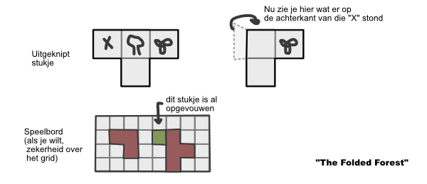
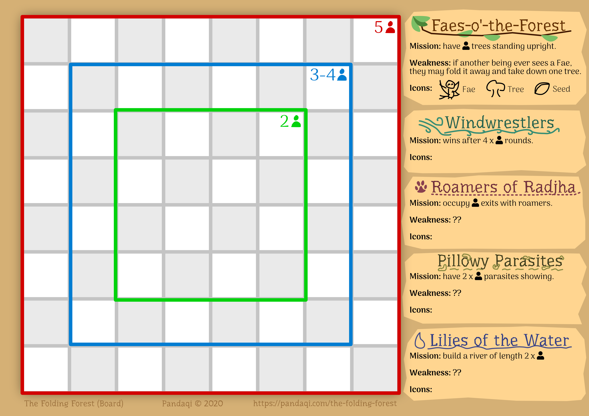

Somewhere hidden between the hills is a magical place called *The Folding Forest*. It is said to harbor the key to all life on earth and many factions in an eternal struggle to protect or control it. As you walk around the forest, it will fold in on itself, move around, blossom like a flower, or grow and take down trees within the blink of an eye.

Take control of a faction and try to end this struggle! But remember, there's always one thing that they all have in common: and that is the *force of the forest*.

## Preparation

You only need to do this *once*! Download and print the *game board* and the *playing pieces*. Place the board on the table, cut the pieces and pre-fold them along the grey lines (so it's clear where they are.)

## Setup

Every player picks a faction and places its starting piece somewhere on the board.

All other pieces are placed beside the board, folded completely open. These are called **off-board** in the rules.

## Objective

Each faction has a unique objective that wins them the game.

## Gameplay

Start player begins. Take clockwise turns until somebody wins.

On your turn, execute *one* action with a piece on which the **majority of icons is yours**. A shared majority also counts. We'll call this the **action piece**.

As long as icons are out of view (because they are on the backside of the paper or hidden by the folds) they are also out of play. You are *not* allowed to check what's on the pieces during the game! (You must memorize whatever you can.)

Icons that belong to factions that are *not* in play, can be used by any player (and are thus excluded when counting).

You cannot *overlap* other pieces before or after movement/rotation.

Choose from:

-   **Move.** Move it one space on the grid.
    -   That's the whole idea: an unfolded piece is *big* and therefore has less movement, a folded piece is *small* and agile.
-   **Rotate.** Rotate the piece one step (counter) clockwise *or* upside-down. You may rotate around *any* point of the piece.
    -   Again, the idea is: an unfolded piece is hard to rotate, *but* triggers more actions. A folded piece is easy to rotate but has less chance of doing anything.

After doing your action, any icons of yours on the *action piece* that become *adjacent* to icons on another piece will activate their action.

(Remember, this includes icons that are *out of play*.) => Is this too strong? Is this possible, but you must take some extra steps/actions/effort to use them?

> **TIAMO FROM FUTURE:** Out of play icons probably should be considered "equal neutral": they all have the *same* somewhat helpful, somewhat unhelpful functionality.

**Exception:** if you're ever in a position in which you *cannot do anything* (you don't own any pieces or your pieces cannot move/rotate), you may perform a FOLD action on any piece for free.

TO DO: Penalty for first player(s)? Otherwise a huge advantage.

## Actions

List of ideas:

-   ADD a new piece to the board. (Perhaps there are several different "ADDS": add any piece, add a piece with restriction X, add it at location Y, etc.)
-   Put a TREE/MOUNTAIN upright, or take it down.
-   FOLD the current piece or an adjacent one. (Very important!)
-   UNFOLD your current piece (like a flower opening itself up?)
-   You may rotate/move an adjacent shape, even if you don't own it.
-   TELEPORT to another empty space on the board.
-   PROTECT a piece or icon against moving/rotating/destroying.
-   TAKE AN EXTRA TURN IMMEDIATELY. (Or BLOCK another player for a single turn? But how would you keep track of that?)
-   When you MOVE (or rotate), do so MORE THAN ONCE. (For example, three steps, or as far as you can in a straight line, or diagonally, whatever.)

## Fold/Unfold

When you may "fold" a piece, this is what you're allowed to do: pick one folding line on the piece (not the edge) and simply *fold* it around that.

An "unfold" works similarly: pick one folding line at the edge and simply *unfold* it.

There are two rules:

-   When folding, the *majority* of icons showing must stay the same. (So, you may never fold away more than half of the piece.)
-   A piece with some part standing upright (such as a tree) may NOT be folded or unfolded.

## Upright Icons

These icons can be put upright (at a 90-degree angle pointing upwards) by certain actions. Among them are trees, etc.

They have two actions:

-   In normal state, they function like any other icon. (Their action triggers when ending up adjacent to something.)
-   When upright, they can't be *adjacent* to anything. Instead they usually perform a different role involving "line of sight".

## Line of Sight

Many actions work via the "line of sight" system. It works as follows:

* Any *upright living being* can see everything in a *straight line ahead of them*.
* This view is only blocked by OTHER upright items, like trees. Otherwise it goes on infinitely.

**Remember**: if something is upright, it shows whatever is on BOTH SIDES. So in most cases, you'll have two living beings looking in opposite directions.

## Seeds

When you are allowed to place a new seed, you:

-   Pick an off-board piece that shows a seed icon.
-   Fold it in any way, such that the seed is showing and nothing else.
-   Place it on the board.

(During the game, this seed will unfold and "blossom" into a flower or tree or something.)

## Factions

The base game has **5 factions**. Each faction has its own backstory, mission, and unique ruleset.

Each faction has at least one **(living) being**, one **nature** element, and one **magical** element (sometimes combined in a single element). The other icons can be anything.

Remember, actions are only triggered whenever this icon lands adjacent to something else, after moving/rotating on your turn.

**TO DO: KEEP IT SIMPLE.** Reduce the number of icons. Allow most icons to be used by most players (as the forest and its nature are SHARED). The difference between players is mostly 1 or 2 unique icons, their personal mission, and personal strength/weakness.

### #1 Faes-o'-the-Forest

*Backstory:* These tiny magical creatures extract small amounts of energy from plants and trees to give it to those that need it more, or to plant new ones. No living soul has ever seen them, for it is said that a single look might corrupt their pure and good nature ...

*Mission:* you immediately win if there are X upright icons (trees, mountains, ...?)

*Weakness:* if a living being ever *sees* one of your Faes, they may fold it away (however they like) *and* take down one tree.

*Icons*:

**Fae (being, magical)**: perform an "(Un)Fold" on each adjacent piece.

**Seed** **(nature):** pick an off-board piece that has a "seed" icon. Fold it such that *only* the seed is showing. Place it anywhere on the board.

**Tree (nature, upright)**:

-   *Normal*: you may put an adjacent icon upright, or tear it down (if applicable).
-   *Upright*: blocks line of sight.

=> should seeds be "faction-neutral"? Or does each faction have its own *type* of seed? Or does each faction have a different way of *getting* those seeds? (Like, for example, the Roamers might poop out seeds and leave them across the board.)

### #2 Windwrestlers

*Backstory:* These represent the elements, vital to the health of the forest, but also out of control of most living beings. They do not care about the petty wars within the forest: they are only concerned with keeping balance across the universe. Of course, if one of the factions would dare temper with that balance ... they might send a whirlwind or two to shut them up.

*Mission:* if no player has won after X turns (or when Y happens), you win.

*Weakness:* ??

*Icons:*

**Sun:** if adjacent to water, fold that piece in such a way that the water is out of view. If adjacent to a tree or plant, you may add a new piece to the board (TO DO restrictions???)

**Cloud ( = wind):** if adjacent to a piece that shows only ONE icon, you may immediately move that piece in a straight line as far as you want. Otherwise TO DO??

**Plant:** ??

IDEA: These are also mostly about photosynthesis: controlling levels of sunlight, oxygen, etc.

### #3 Roamers of Radjha

*Backstory:* These animals are hungry for survival, for which they need food and, most of all, space to roam. If they manage to escape, the forest fears that the earth will fall not soon after.

*Mission:* TO DO something about "leaving the forest" (have as many roamers at the edges of the board as there are players?)

*Weakness:* they need to eat and drink. As such, ??

*Icons: ??*

**Roamer:** ??

**Soul/Spirit/Life Force:** ??

**Icon 3:** ??

### #4 Pillowy Parasites

*Backstory:* These little creatures can only survive by latching onto other plants and animals. They are sorely needed in the forest, for nutrients, transport and diversity. But allow their growth to get out of hand, and they would overwhelm even the strongest of trees.

*Mission:* something about how MANY of these icons are showing. Or how many of them are ADJACENT to other nature elements (and they "latch onto them")

=> If they manage to fold a piece such that ONLY a parasite is showing on top, it is infected and will always stay that way?

*Weakness: ??*

*Icons: ??*

**Parasite:** ??

-   Normal: also activate the actions on icons from *other players*
-   Upright: TO DO

**Bacteria ( = nutrients/good soil):** ??

**Dark Sickness ( = the nuclear option if needed?):** ??

### #5 Lilies of (the) Weary Water

*Backstory:* A mystical force present in everything related to water. They are *living*, and can transform between states (water, to plant, to animal), though no human can see or comprehend them. As long as they keep flowing, the forest remains strong. But if the water dries, or gets contaminated and poisoned, all life is endangered.

*Mission:* create a river that's twice as long as the number of players.

*Weakness: ??*

*Icons: ??*

**Lily (living, upright):** ?? => use the fact they can TRANSFORM between all states

**Water (nature)**: multiple adjacent water icons form a *river* (longest sequence of adjacent water icons). This gives benefit Y.

**Icon 3:** ??

Icon Ideas:

-   **Mountain (nature, upright)**: nah, doesn't feel like it should be in the forest
-   **Flower (nature)**:
-   **Mirror**: reflects back whatever looks into it. (Or can it also *angle* that look? Is that where sideways folds, creating triangles, comes in?) => ICE WATERFALL? => LILY?

IDEA:

-   The art/icons of this game have clear **folds** in them. (Like those flat shadow, minimal icons with a line down the center. Although I should be more creative.)
-   Maybe I should look at spiritual icons, forest themes for inspiration
-   I could also give icons a paper-like, origami look ... although that might be confusing when used in an actual One Paper Game.
-   In any case, icons should all be SIMPLE enough that players can draw them by hand if required.

IDEA: The Faes can "store" energy. How?

-   When they store it, they pull themselves upright. They can't be pulled down by anyone else.
-   You can choose to *use* the energy you stored later on. (After using it, put the Fae down again.)
-   This would case Faes to be *living beings* => which means that *trees* need to belong to EVERYONE (they are faction-neutral).