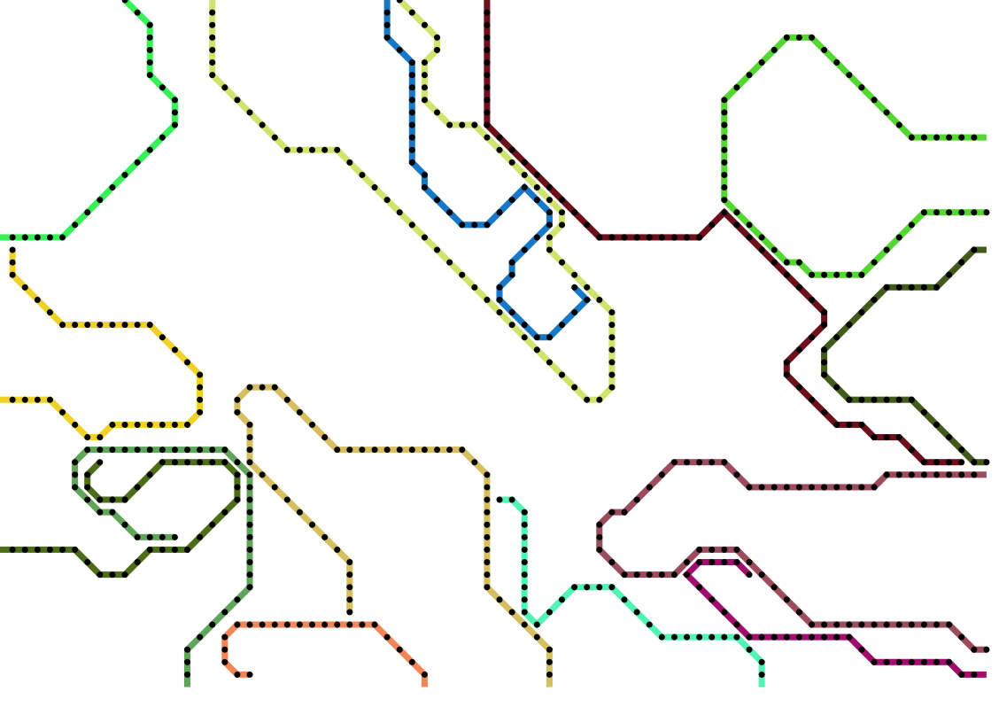
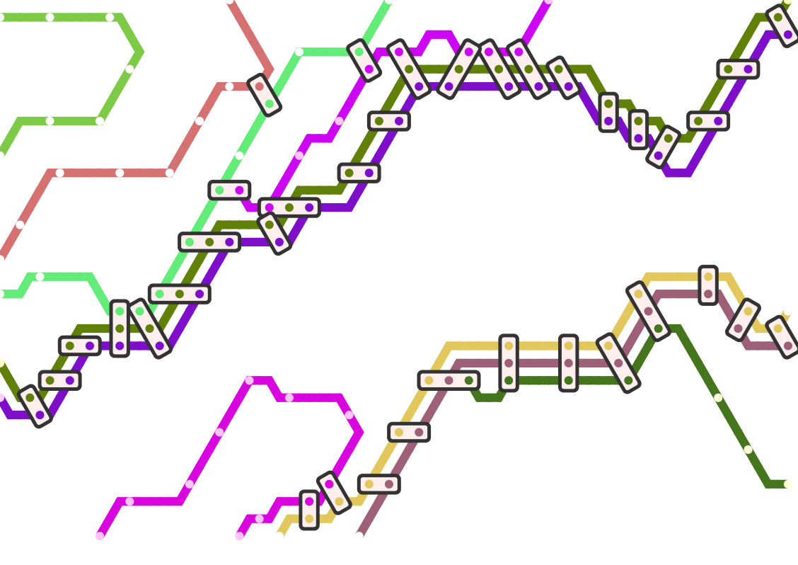
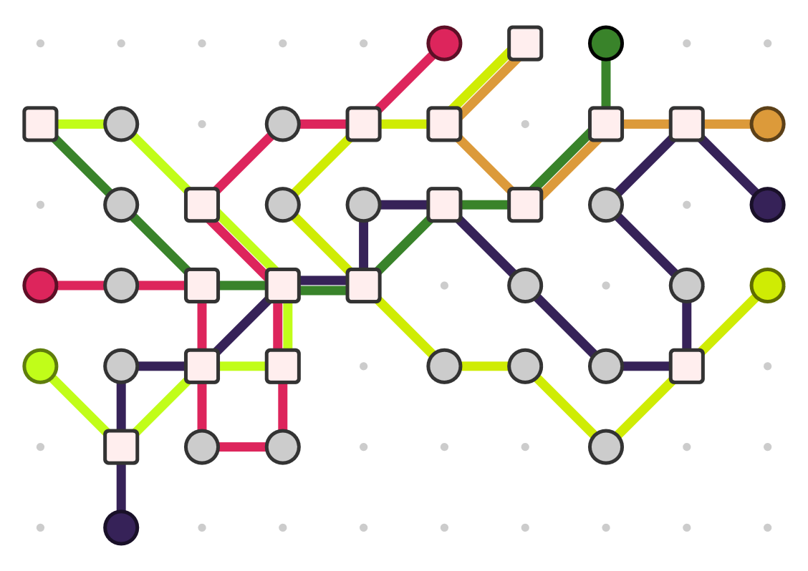

**A "One Paper Game" about building a metro network for Hades to make his underworld function more smoothly.**

This idea is really promising, but I got it at the wrong time, massively overcomplicated it, then moved on.

Below are three boards I generated as my algorithm got better and better at creating random "metro maps" to play on.

The idea is that players simply write down a symbol inside metro stations (or cross out/add stations and routes). At the end, you want to own as much of the network as possible and score as many points as possible.

## Setup

Go to the website, generate a random board and print it.

Each player invents their own symbol and picks a route to start on. ( = draw the symbol at the dead-end starting station of that route?)

## Objective

When (at most) one player is left in the game, aka nobody else can take a turn, the game ends once that round is over.

The player who **helped the most spirits to their final destination** wins. In case of a tie, the player that collected the most **hearts** wins.

## Gameplay

Play goes in rounds until the end of the game. Each round, everyone gets a single turn:

-   All players who are alone on their route, may take turns simultaneously.
-   If multiple players are on the same route, they must **challenge** each other for who goes first.

Each round, one player is *Hades*, instructing others what they must do this turn. At the end of the round, this role shifts to the player on the left.

## Hades

You decide what happens on your round:

-   **New Spirits:** create a selection of two spirits. All other players may pick one of those and add them to a station? Or their personal transport area?
-   **Move:** move along a subway route
-   **Switch:** switch between routes (on a station) => not applicable on simplified boards though?
-   **Special ability:** you can "store" these up, or they can be acquired if you're at a certain location, and must be used now.
    -   **Draw:** draw an extra subway line between any two points
    -   **Extra Car:** you get an extra railway car => what does this mean?!

ON SIMPLIFIED BOARDS: There is no concept of "switching" routes, but also no concept of "being on one route in particular". This would mean simultaneous play is not possible, which isn't nice.

ON RECTANGLE/HEXAGON BOARDS: Routes are literally one connected line, and will not (or rarely) cross. So you can't do anything *but* stay on one route or switch between them.

## Why I Quit The Idea (I Think)

**IDEA:** Cut the board into 4 parts. 1 part = 1 player. (So, for a three player game, you'd need three of those parts.)

These parts will simply contain a few stations, a few routes, a few special elements ... and the rest are dots.

**REMARK:** I should play to the *strengths* of One Paper Games. Now I try to recreate the idea of sending metro trains with pen and paper ... but it just doesn't work. Why? Because trains *move*, passengers *move*, nothing is permanent.

How can we change this to work properly?

> **SOLUTION 1:** Focus on drawing/creating the route and placing the stations. Those ARE permanent and we can get as creative as we want.
>
> **SOLUTION 2:** View "moving passengers" or "moving trains" as an instant action. Instead of crossing out the icon, and drawing it again *all the time*, just *do it once*.
>
> But, this action is limited by the *existing routes*, and *which passengers you move*. That's why the routes and movements are important.
>
> **"The dead are restless"** => after visiting a place once, or several times, it's simply fixed when it comes to content/number/type/trains.
>
> **IN FACT**, it might be interesting to make it a challenge to *stop at the right location*.

## Separate Ideas & Considerations

Lala

IDEA: **Spirits appear at stations**. (Like *Mini Metro*, you need to adapt to the board state, and get people where they need to be (before it gets too busy)).

However, where they appear depends on the board state. (Use some simple formula that's easy to see through, but can be changed, so you have *some* influence.)

IDEA: Multiple "levels" => when generating, it creates multiple levels, with several stations functioning as "gateways". If you're there, you can take the stairs to another level (higher or lower).

> Maybe the uppermost level are simply trains, and the lowermost level is very scarce when it comes to connections.

IDEA: At the start of routes, there are free spaces. By writing your icon in there, you signal that *you* are on that route and may take actions there?

> Follow-up idea: routes always go in one direction. The "big squares" only keep track of where the *car* currently is -- you don't draw player symbols there.
>
> You can't move onto a crossing from another route, if it's being blocked by a car.
>
> You also can't move somewhere if there's no car there (yet).

IDEA: *Draw* your own extra connections/stations/whatever

> Step 1) The board has grid dots to help know where you can draw.
>
> **!!** Step 2) After generating the board, I randomly REMOVE/HIDE parts of it? So it also becomes a puzzle about connecting the right parts together as efficiently as possible.

IDEA: When moving, move a specific *amount*. (Like in MetroX.) So you want to optimize how much you use that, instead of being blocked and only moving a little.

IDEA: Give routes LETTERS as names. (Easier for reference, seems to be the standard.)

> => Maybe spirits simply want to go to the endpoint of a specific route. So, the "blue/circle" spirit always wants to go (one of the) endpoints of that line.

IDEA: You may not cross the same point/intersection twice?

IDEA: You *can* draw in the same space as someone else, but that brings a *penalty*.

IDEA:

-   You *skip* over stations that are already filled.
-   You either move along your own route, or switch to a new one (if you're at a station).
-   Players take simultaneous turns. You only get a conflict if players are on the same route.
    -   But ... how does this work with the One Paper Game aspect? Where you always stay on the board forever?

IDEA: You can decide *yourself* which spirits you transport and what their properties are? (By drawing them, following some restrictions and rules of course.)

> Although this is new and innovative, it removes the "puzzle" aspect where you move around the board to *pick up* the right spirits at certain stations.
>
> IDEA: Certain locations are only worth something if you have that specific spirit in your train. (Maybe, to simplify the game, locations of type X *always* want spirits of type Y, no exceptions.)

IDEA: Make it so there can *never* be a tie on the number of hearts players have? Adjust the rules to do this automatically?

IDEA: Multiple trains per person? Expansion/extra?

> Designate your trains with your *symbol*, and which one it is with a *number inside that symbol*.
>
> Then, on the edge of the board (or another designated area), connect each *number* to whatever spirits/souls they are carrying.

IDEA: Stations are (jokingly) named after things you need to do when you get to the underworld. ("Sin-Forgiving Machine", "Ghost Make-over", "Weighing of the Soul", "Memory Lane", "...")

## Original Idea

**Real game: Metro-X** (check rules again, quite interesting)

**My clone:** turn the whole paper into a randomly generated set of subway lines. Players can choose from several options, they must invade each other\'s spaces, draw X-es where they can, open/close stations or add more subway cars. To win, you need to have your symbol on the board the most? Or you get points for delivering people?

### Fonts

These are picks from Google Fonts:

-   Sansita Swashed: nice thick curved font, a nice representation for the underworld (<https://fonts.google.com/specimen/Sansita+Swashed>)
-   David Libre: classy, work-horse font but still unqiue (<https://fonts.google.com/specimen/David+Libre>)
-   Secular One: thick, combines playful with "underground/tube" font (<https://fonts.google.com/specimen/Secular+One>)
-   Manrope: thinner, less pronounced font (<https://fonts.google.com/specimen/Manrope>)
-   Gamja Flower: feels like it could be a mix of the dark side of the underworld, and something more playful ([https://fonts.google.com/specimen/Gamja+Flower](https://fonts.google.com/specimen/Gamja+Flower?query=flow))

These are actual Metro fonts (or copies/inspired versions of them):

-   Europe Underground: *really nice* (<https://www.dafont.com/europe-underground.font>)
-   P22 Johnston Underground: old version of official London Underground font -- not sure if I can use (<https://fontsgeek.com/fonts/P22-Johnston-Underground-Regular>)
-   London Tube: inspired by it, freeware (<https://www.fontspace.com/london-tube-font-f2717>)

NON-RELATED: Nice fonts I found on Font Squirrel:

-   Riffic:
-   Questa Sans

### Themed Idea

Hades has some trouble controlling his underworld. There are just too many souls arriving! And all of them have different needs, curses and treatments!

He has asked you to take care of his troubles. The player who wins ( = TO DO OBJECTIVE HERE) will officially receive the job as Conductor of the Underground, for all eternity. Isn't that nice?

(The **name** of this game is a double pun. You are train conductors controlling a metro network. You are also "conducting an orchestra" as you try to make everything function smoothly and keep a nice flow/rhythm to the transit.)

**On Map Generation**

Usually, metro lines line up in perfect angles. Additionally, when two lines meet, they try to line up ( = run parallel) and then simply draw an ellipse around the whole thing.

**Perfect angles:** Horizontal, vertical, 45 degrees, 30/60 degrees. (One can also use curved lines, but that seems more difficult.)

**Roads:** lines try to run parallel at equal distances.

**Marks:** I see two systems.

Fluid:

-   Tiny dot within (thick) line = stop
-   Dot with a border around it = interchange (a split, but still the same line)
-   Multiple dots with an ellipse around it = large interchange (a big station where multiple lines connect)

Rigid:

-   Dot for stops.
-   (Big) square where multiple things meet
-   Half-square for dead-ends.

Transit maps also show landmarks: *water, parks, mountains/big obstacles, etc.*

Transit maps can also show multiple types of transit:

-   Train
-   Metro
-   Light Rail ( = "anything between metro and train")

**IN CONCLUSION:** I probably don't want to go for "realism" or complete randomness.

Instead, I should create a few "nice lines" beforehand, place dots according to those, then place random railroads with some conditions:

-   Everything should be reachable.
-   Connections should be logical. (If you're very close to a dot, but your fastest connection is quite a long way around, add a new road that goes directly there.)
-   High-density areas get more lines.
-   Keep lines going as long as possible (never randomly stop or something).
