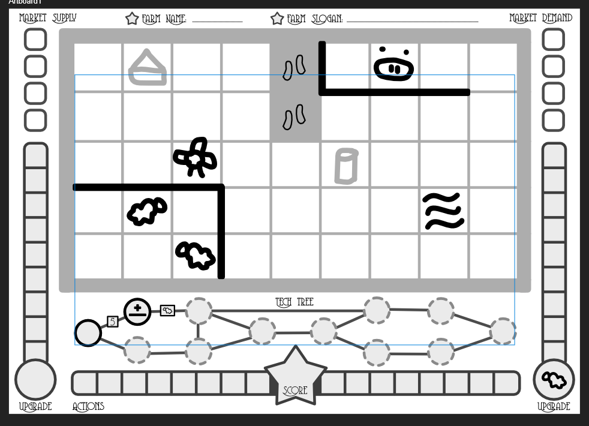

A roll-n-write game about running your own farm.

Here's a very rough sketch of what the paper might look like.

## Updated Idea (V2)

### On Your Turn

**Pick 2 slots from your ACTIONS.** 

* Cross them out. 
* Everyone must place one of these on their paper. 
* You may place both.

If you can't pick two actions, you're out of the game.

### Parts of the Paper

What does every part do?

**Actions:** if there's a free slot, you can always place anything in it.

**Upgrade:** you have one opportunity to place an icon in the circle. Place numbers here in ascending order, bottom to top. This thing's point value is equal to how many slots you filled.

> Note: Could possibly be much smaller, otherwise it breaks the game to fill this bar very far.

**Tech Tree:** the reward (inside circles) is randomized and fixed upon print. The cost of upgrading (squares on lines) might still be open. You can place anything in there.

* If you pay the right cost, you can encircle (+ cross out cost) the next option in the tree that you want. 
* All rules are basically "... unless your tech allows it"

**Map:** starts with some things already fixed, randomized.

Draw fences on the lines or icons within empty squares. At the end ...

* You only get points for every animal within a fenced-off area. Animals are not allowed to be mixed within an area.
* You get points for the longest path through your farm. => Or 1 point per path next to a fence? I want to encourage building good-looking farms
* You only get points for your biggest (adjacent) group of crops. Points = # crops in the group (too harsh, leave as bonus in tech tree) => Crops cannot be next to animals, unless there's a fence in between?
* Buildings can change point values or what's allowed on the map

**Market:** You can place anything within a (free) supply slot. You can place numbers within the demand slot.

* At the end of each round, we check if there is both demand and supply. 
* If so, the person with the highest demand number gets everything that is supplied.
* All demand and supply slots used are crossed out.
  * IDEA: if nothing happens on the market, all players count the number of open squares in their farm, and add that number to their actions bar.

CAMPAIGN => Make all these different Parts/Sections _optional_! So you can play a first game with only the basics, and ramp up from there.

> This would benefit from different placement, otherwise it looks odd. Place the farm to the LEFT, leave empty space for a proper tech tree on the RIGHT half.

REMAINING ISSUES:
* There needs to be some way to "pick whatever you want" or "pick any animal". Otherwise, all your options are already determined right from the start through the actions bar.
* The same is true for numbers. How do we randomize that?
* A way to combine the two options? (So you can pick sheep + three, and it would mean place three sheep?)
* Solo play??
* Tech tree should be larger. Rather too much space than too little.
* Keep it simple. Number of unique rules and icons should be smaller than it is now, I think.
	Two animals
	Two crops
	Three "buildings": water, path + something
	Numbers go 0-6

## Original Idea (V1)

Randomly generated. One A4 paper can hold *four* separate papers. (Cut at center lines.)

On the paper is ...

-   A gamey representation of a farm. (Squares? Network of nodes? List of animals? Even more abstract?)
-   A list of options in some way. (Probably both a *type* and a *number*.)
    -   These options might be linked to locations on the farm. Like surrounding nodes or within the list. So crossing them off might have an impact on which options you can choose *later*.)
    -   Alternatively, players might *draw* these options themselves. I mean, that's the power of a *writing* game.

When it's your turn, you

-   Cross off an option and call it out
-   *Everyone* executes that option on their paper (within the farm)

And then it's simply **whoever ends up with the most points.**

**Possible mechanics:**

-   **(Line)** Add fences to divide fields.
    -   Only get points for closed-off fields that contain *one* animal type
-   **(Icon)** An upgrade bar:
    -   Draw an animal (or more) at the bottom
    -   Fill the bar
    -   The higher it is, the *more* points you score for that animal (or crop)
-   **(Cross off? Icon?)** A technology network on which you can progress.
    -   Again, you might be able to fill in some things yourself
-   **(Number)** A general *marketplace*. Once in a while, a player triggers the market action. Whatever is in the market will be distributed, but only to the player(s) with the highest bid(s).
    -   These numbers must be placed in sequence? Only reset on fives?
    -   But without dice, how do we get truly random numbers? => It would have to depend on your *board state*.

At the bottom is a list (horizontal) with squares. This can hold anything (number, icon, etcetera.) You start with some options, but can *add* stuff there later.

This list is where you **choose your turn**. You must pick two things. Other players only need to implement one of them.

If you ever run out of options in this list (you have 0-1 left), you are out of the game until the end.

_Coventry Garden_ is a nice font for this one.

**THE ONLY LEFTOVER ISSUE:** How to streamline options? How to make it clear *what* you can write in each field? (Animals/crops on fields, numbers ??, fences between fields, etcetera.)

**FURTHER IDEAS:**

-   Procreation?
-   Automation?
-   Upgrading processes?