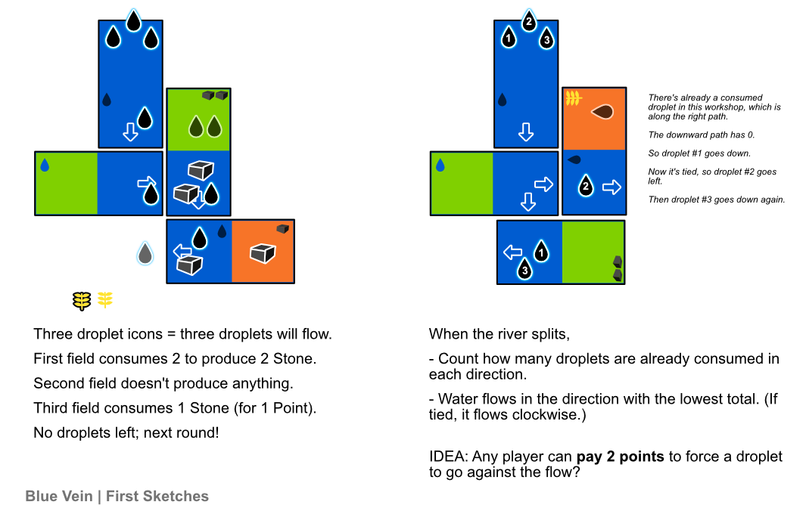

_Blue Vein_ references a crucial river: the Nile. (It also references the pharaos/emperors with "blue blood".)

If I could find a way to make the base game ONLY about the **fields**, then it would make the first game/explanation even simpler and more approachable.

Here's a quick sketch of the general game idea/turns. Below is the full rules explanation.

## Material

There are three possible **domino parts**: rivers, fields and workshops
.
* RIVERS extend the Nile (and allow places to be reached). These can show an arrow.
* FIELDS turn water into goods.
* WORKSHOPS turn goods into points (for the player who owns them).

The type of good produced/accepted depends on the specific parts inside the field/workshop.

Each domino part can show an icon.
* A droplet (_this adds more water to the flow phase_)
* A type of good (_to produce/accept in fields/workshops_)
* A power icon (_activated during flow phase by paying a droplet or good_)

## Setup

Give every player X tokens of the same color. (You'll use these to mark fields/workshops as yours.)

Give every player Y (domino) cards.

Finally, place the Nile tile on the table. (Make sure there's enough space below it, where its arrows point, to build for the rest of the game.)

_This Nile tile shows a bunch of water droplets + an arrow for flow + is completely water_

## Objective

The game ends once _two_ players have placed their last claim token. Most points wins.

## Gameplay

Take clockwise turns doing a PLACE action. At the end of each round---after each player has taken one turn---execute a FLOW phase.

### Place

On your turn, place 1 to 3 dominoes on the board. If you have enough tokens, you may claim any of their part(s).

Any river parts on the dominoes must match the existing river _and_ its flow. All other parts can be freely placed.

You're not allowed to place a domino that makes it impossible to extend the Nile further.

Then draw your hand back up to X.

### Flow

Count the number of "droplet icons". Place that many water droplets at the start of the Nile. 

Move them **one at a time**, following the arrows, until everything on the river is used somewhere or exits the map.

If a stream **splits** (it has multiple arrows),
* Count the number of droplets (and goods?) present along each branch, consumed or not.
* Flow into the branch with the **lowest** total.
* If tied, pick the first branch clockwise.

Everything _on the river_ follows the same general rule.

> When anything flows past a part that _can_ accept it, it's consumed by it.

EXAMPLE: The first time a droplet passes by a field, the field will consume the droplet (stopping its flow) and produce the good.

When done, players count their score for this round. Count the number of GOODS that landed on your workshop, then remove them from the map.

Finally, remove all droplets and start the next round.

## Fields & Workshops

Any connected set of field/workshop parts is one _field/workshop_. Such a section can only be claimed by one player. (It can be extended after claiming it, by anyone.)

* A claimed field **accepts droplets** and can produce all the **goods** (icons) that it shows. It only produces _one_ good per water droplet. You can't use an icon twice in the same round.
* A claimed workshop **accepts goods**, but only from the **goods** (icons) that it shows. It produces _one_ point per good. You can't use an icon twice in the same round.

Unclaimed fields/workshops only accept a **claim token**.

When a field is activated, the owner decides whether to put any goods from their field onto an adjacent **river**.

If you threw goods into the river, you must now handle them before flowing the next droplet. The owner decides the order in which they flow.

Finally, you can also throw your _claim_ token onto the river whenever a droplet passes a field/workshop of yours.

EXAMPLE: 
* Three water droplets pass a field showing 1 Stone and 1 Grain.
* The field consumes two droplets and produces stone and grain, which the player decides to throw onto the river.
* The remaining water droplet continues on its way.

EXAMPLE:
* 2 stone pass a workshop showing 1 Grain.
* It doesn't accept it, so nothing happens.

EXAMPLE:
* 2 stone pass a workshop showing 1 Stone.
* It grabs 1 Stone (to score 1 point).
* The other continues on its way.

IDEA: Some edges have walls or dams? (To prevent having too many splits/open edges?)
