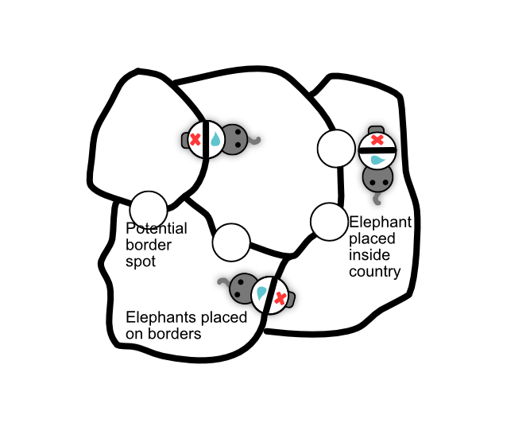

Here's a sketch that mostly illustrates the idea.

## Setup

The map could be **randomly generated** (like OPG) or created from a set of **hexagon tiles**.

* It should be a set of **countries / areas** with clearly defined (mostly straight) borders.
* Each player has a bunch of **elephant** tokens.
	* They have a basket on their back split in 2 (with a straight line).
	* They clearly face one way (shown by their head/trunk)

## Gameplay

On your turn, you **add** or **remove** an elephant.

* When removing, you simply take an elephant of yours off the board.
* When adding, you have a choice: add to **border** or to **country**. 

BORDER: place the token on a free spot _between countries_, such that the line of their basket matches the country border. This means one part will be inside one country, and the other part inside the other.

COUNTRY: place the elephant inside a country you control. (The majority of elephants looking _into_ the country is yours.) When placed here, the icons on their back are ignored.

Finally, trigger the two actions from the elephant you just placed.

## Actions

Possible actions/rewards:
* **Military** (most common?): a number (positive or negative) which changes the military strength of the country its in.
* **Rotate**: rotates _all_ your elephants the other way (180 degrees).
* **Destroy**: remove another player's elephant. (Only if connected to same area?)
* **Buy**: buy a new elephant token (just the top of the randomized deck?)
* **Attack**: perform one attack.

### Attack
A country of yours can successfully attack an adjacent country if you have a **higher military strength**.

Military strength = number of elephants + modifiers from border elephants.

If you do, wipe out anything inside, and move at least one elephant from the original country into the conquered country.

**@VERDICT: Might work nicely, not sure yet.** 
* The biggest doubt comes from the triggering part. We need some smart way to connect everything => how much money do you have for buying? Can we _chain_ elephant powers after placing them?
* We also need an objective :p