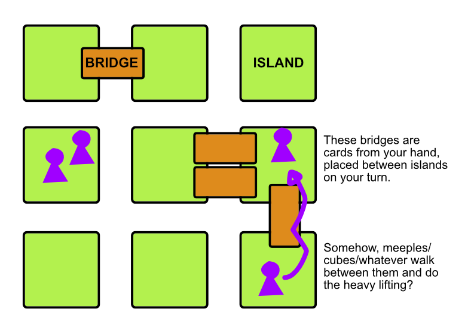

A game about placing bridges between islands to connect pathways. Negotiate passage on the bridges of other players, and make sure they want to use _yours_ all the time too, to profit the most and score the most points.

Let's seen a visual sketch first.

Now let's see a rules sketch below.

## Setup

Place X islands on the table, in any formation you want. (Leave some space between tiles to clearly separate them.) 

If this is your first game, just place them in a **grid**, and make the number of islands roughly **triple** the number of players. (Example: 4 players = 12 tiles in a 4x3.)

Each player picks a color. They get all pawns and bridges in that color.

In clockwise order, from start player,
* Place 1 pawn on any island of your choice.
* Place 1 bridge on any free connection between islands.

Finally, for each island that has _no_ pawns and _no_ bridges now, draw a Lumicore tile and place it there.

## Objective

The game ends once all **Lumicore** have been collected. On the tile itself, it states how many points each is worth. Highest score wins!

## Gameplay

Play happens in rounds. Each round, draw as many **action cards** from the deck as there are players, and place them faceup in a row. (If the Action deck is empty, shuffle the discard and turn it facedown to get the new deck.)

Beginning with the start player, take clockwise turns. On your turn, grab and execute one available **action card**. (Once done, discard it.)

Whenever you have **3 (or more) people** on an island with a Lumicore, you get it immediately.

That's it; the meat of this game comes from the action cards.

## Action Cards

### Start Player

You become start player next round. You may also look at the top 3 Lumicore or Action cards of the deck.

### Buy a Bridge

Place a new bridge to connect two islands (horizontally or vertically). Both islands must have a free slot at their edge ( = printed on tiles, can be 1 or 2?)

### Buy a Worker

Add X pawns onto an island where you already are.

### Discover a Lumicore

Draw a the top Lumicore tile from the deck. Place it on any island.

Most Lumicores have restrictions on them, such as "can't place on island with bridges" or "can't place on island with your pawns"

### Move Workers

Move X steps. (You decide how to distribute these across workers. One worker can do all steps, or many can do one step.)

A "step" means moving from your island to another island over **a bridge of yours**.

You can only use another player's bridge if they **give permission.** You may negotiate or bribe however you want. (_Promise to let them use yours. Give them 1 low-value Lumicore of yours. Etcetera._)

If you've moved (at least) **2 pawns** over a bridge, you may **move the bridge**. Place it in another free slot at the new island.

### Battle

Pick an island. 
* If you have _more pawns than any other player here_ (ties not allowed), all other pawns are removed.
* If that's not the case, destroy 2 bridges from any island.

## Improvements

**@IDEA: You can save actions.** You draw the tile, but don't execute it. You can save 3 actions at most: when you get your third, you must execute them all at once.

**@IDEA: Some way to reuse the existing material for money or points.** It gives more bargaining tools and "divides" the process of buying a bridge into smaller steps.

**@IDEA: Different icons or properties to the bridges themselves.** (More/less pawns needed for moving. Double as money or bargaining tool.)

## Material

* Bridges (thinnger/longer cards) + Pawns in 5 colors.
* ~20 Islands (thick square tiles)
* ~20 Lumicore tiles
* ~20 Action Cards

Alternative name: _Lumicore Island_

This was partially inspired by the idea of Bridge Runs from _Stormlight Archive_.

