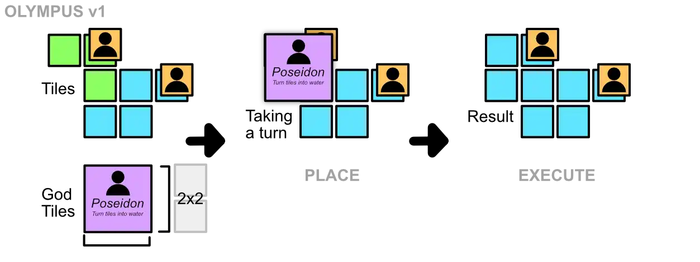
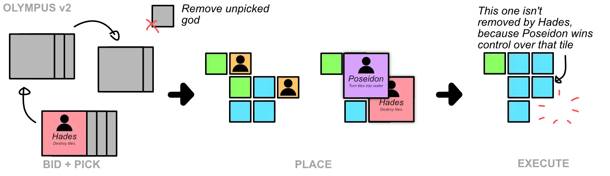
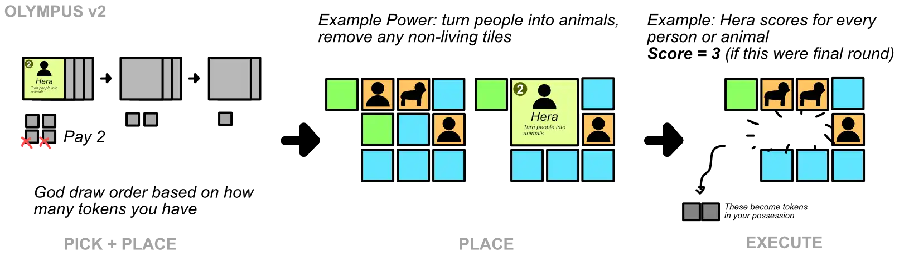

**A game about Greek mythology.** As always, keep it extremely simple, light, accessible, little material to print.

You constantly pick which God you want to use this turn. Then you use them by _placing their tile on top of the world_. Their godly powers only influence the _part of the map you cover_. 

This creates a very strategical game about managing the space, maximizing the effect of godly powers (or minimizing the effect of bad ones), and trying to find the perfect spot for that God tile. All with very simple rules.

Below are three sketches that basically explain the entire game.

## Setup

Create and shuffle a deck of God tiles.

Create a deck of World tiles. Keep *Clouds* in a separate pile. Now shuffle and place 4 random World tiles in a 2x2 grid on the table.

## Objective

Once there are **as many Gods left (in the game/deck) as there are players**, you play the final round.

The god you picked in this last round is what you use for *scoring*. Highest score wins.

## Gameplay

Each round has two phases: **pick and place, then execute.**

These phases do **not** happen in clockwise order. Instead, at the start of a round, order the players based on how many *tokens* they possess. Do so from high to low. Ties are won by the player who is *closer* to the (previous) starting player, in clockwise direction.

> Example: A has 2 tokens, B has 4 tokens, C has 2 tokens. Then B goes first, then C (closer in clockwise order), then A.

Each God has a fixed cost for using them (as this also allows balancing their powers further). If you can't pay _any_ God when it's your turn to pick one, you choose none of them and get 3 random tokens.

### Pick

Randomly draw `(#players + 1)` God cards. The start player gets this pile and picks one. While placing it, they already pass on the pile to the *next* player.

Placing means putting the God tile **over** a 2x2 area of the map. (This means that the God's power will affect this little area.)

You can overlap other gods, but never *fully overlap one God tile*.

This continues around the table, until all players have picked and placed a god. The last (unpicked) god is *removed from the game*.

### Execute

Players execute their God's power. (Still in the same order, one by one.) The power is only relevant to the area you underneath your God tile, which isn't covered by another God overlapping you.

Any tiles you remove from the board on your turn go into your possession. (This means actual destruction, but also swapping/replacing. It simply refers to any tile that *used to be on the board, but now isn't anymore.*)

*Remark*: you may not remove a tile if that would break the world into separate pieces? Feels like the cleanest solution to that problem.

*Remark:* for a smaller/faster game, draw (#player + 2) gods and remove the two unpicked ones. For a longer/bigger game, allow players to draw TWO gods?

## Tile Types

-   **Ocean** (used by *Poseidon, Hephaestus*)
-   **(Raw) Resource** (used by *Hephaestus*)
-   **Food** (used by *Hestia*, *Dionysus*)
-   **Nature (Tree/Plant)** (used by *Demeter*)
-   **Person** (used by *Hera, Aphrodite, Hades, Hermes, Athena?)*
-   **Animal** (used by *Hera, Artemis*)
-   **Building** (used by *Athena, Hephaestus, Hermes*)
-   **Cloud** (used by *Zeus, Apollo*)

Figure out **Dionysus**. (His scoring rule is really cool, but he should really do something to bolster the weak tiles.)

The weak tiles: Food/Nature/Raw Resources.

## Gods

### Zeus

*God of the sky, weather, lightning, and having affairs.*

**Power:** any tile underneath is swapped with a cloud. Any cloud underneath is swapped with a random tile. Can't be overlapped by other gods.

**Score:** the number of clouds in the largest cloud (group)

### Poseidon

*God of the sea, storms, earthquakes and horses.*

**Power:** fill gaps with water tiles. Any existing water tile grows: replace one adjacent tile with water. Any non-water tile produces an earthquake: people on adjacent tiles die and are removed.

**Score:** 1 point for every ocean tile. (Or the *longest river*?)

### Hera

*Goddess of childbirth, marriage, women, and heavens.*

**Power:** turn all tiles into *people*. Existing people change into *animals*. When you overlap another god, move them to another place ( = "queen of gods")

**Score:** +1 point for every person tile.

> Alternative: +2 points for every male and female next to each other?

### Demeter

*Goddess of nature, agriculture, harvest, fertility, seasons.*

**Power:** draw 4 new (random) tiles. Fill any gaps. Existing tiles may only be replaced by a *tree*.

**Score:** the number of tiles in the longest side of the board.

> Alternative: number of plants/biggest group of plants

### Ares

*God of warfare, destruction, and bloodshed.*

**Power:** destroys all tiles underneath it.

**Scoring:** scores 1 point for every *gap* in the world. (An enclosed space without a tile.)

### Aphrodite

*Goddess of love, beauty, desire, emotions, pleasure.*

**Power:** any people adjacent to her area are drawn in: moved into the 2x2 space. If something already exists, swap with that tile. (Any remaining gaps are ... ignored?)

**Score:** +1 point for every person or animal next to another.

### Athena

*Goddess of wisdom, strategy, strategic warfare, skill, civilization. (Also good with curses.)*

**Power:** place buildings underneath it. Any tile that already had a building, produces persons on all adjacent tiles.?

**Score:** +1 point for every person next to a building. (+1 point for every building next to a gap?)

### Artemis

*Goddess of animals, hunt, mercy.*

**Power:** Any animals underneath it become food. Any tiles without an animal *become* an animal. Any food underneath it is swapped with an adjacent tile.

**Score:** +1 point per animal.

### Apollo

*God of archery, music, prophecy, and healing. Brings sunlight and well-being, ability to see the future.*

**Power:** simply protects tiles underneath it from any harm. Removes any clouds. Then draw one random tile and place it anywhere (connected to the board).

**Score:** scores as many points as the number of times the *least occurring tile* appears. (This means you're focused on diversity---every tile type grows equally quickly---which befits Apollo.)

### Hephaestus

*God of fire/heat, resources, (supernatural) strength, craftsmanship*

**Power:** place a raw resource in gaps, convert existing resources to buildings, and remove any ocean.

**Score:** +1 point for every resource, +2 points for every building, 0 points for any tile next to water.

### Hermes

*God of diplomacy, travel, communication, sports, persuasion/trickery, luck. (Also responsible for accompanying dead to underworld. And creating alchemical/magical potions.)*

**Power:** move the tiles underneath it to some other place (still connected to the board).

**Scoring:** scores for the *largest distance* between two buildings, which are connected through a road of people/animals.

### Dionysus

*God of wine and theater ("merriment"), power, rage, lust, passion. Could see the future and shapeshift.*

**Power:** swap tiles underneath for different types ( = "shapeshift"). Half of those (rounded up) are drawn randomly, half can be handpicked from the deck.

> Alternative: any *gaps* receive a new hand-picked tile, but swaps occur randomly?

**Scoring:** +1 point for every tile enclosed by different tiles (on all sides)

> Alternative: simply +1 point for every "grapevine" or "entertainment tile"
>
> *Might also do something with buildings? A building surrounded by people on all sides is a "theater" and scores points?*

### Hestia

*Goddess of hearth fire, home, family, cooking, health.*

**Power:** any *animals* or *nature* beneath it turns into food. Any food underneath it is removed.

**Score:** for #food or #people next to food?

> +3 points for every building surrounded by people on all sides?
>
> +1 point for every connected group of 3 or more people?

### Hades

*God of death, underworld, afterlife, ??*

**Power:** remove all people and animals underneath it. Fill all empty spaces with non-living tiles. (Draw randomly from the deck until you have enough.)

**Score:** the number of people/animal tokens *in your possession*. (Or the largest number in *anyone's* possession?)

Other "sort-of-Olympus" gods: Leto, Heracles

## Other Versions

The rules given above are for the tile-based version, which is the first idea I had and probably the strongest one.

### Card-Based

This version would include loads of *minor gods, heroes, monsters and side characters*. This bigger deck would, somehow, be the engine of the whole game.

### Chip-Based

This would be about **gaining favor / offering.**

-   Could be a bag-building game. You build a bag with tokens of gods. Whatever you get in a round is all you can enter when bidding for god powers.
-   Or these tokens are simply open and they only grow and grow.

The "current gods" are on the table. Everybody is allowed to bid a number of their offer tokens. Highest offer gets that god's power this round. (Anything bid is removed, to prevent one player just growing on power and always claiming that one god.)

### Party-Based

The other extreme: a slimmed-down version. Only the 12 major god cards, nothing else. More of a role-based game, near Werewolf or Machiavelli.

### Tile-based (My Doubts/Considerations)

_Alternative Name: Colympus IF we make the game cooperative._

**IMPROVEMENTS:**

-   See if I can reduce tile types + simplify God powers
-   And make all of them equally relevant. (Equally many Gods that can do something with them.)
-   Then finish God powers and we have a game.

**@IDEA:** Use adjacency for god powers

-   "Give 1 token to every God adjacent/overlapping"
-   "You take over the power of any God adjacent/overlapping" (if none, you simply do nothing)

**@IDEA:** Use the specific tokens you have in your actions. (Maybe you can do different things when paying different tokens, or stronger/weaker versions.)

**@ISSUE:** Handling the gods might be tricky if they *overlap*. You need to remember, even after a God is removed, that some part of your overlap isn't valid/already handled.

> And in what *order* do you even go? Most gods keep to their own area, but some also swap/target adjacent tiles?

General Lessons:

-   **Lesson 1**: Position should really matter. Gods that leave gaps, swap places, move things to the outside, should *matter*.
-   **Lesson 2:** There are fewer tiles than there are gods. This means most gods influence *multiple* things and can be used for multiple strategies.
-   **Lesson 3:** It feels like there should be a distinction between "draw random tile from deck" and decks divided by *type* (so you can draw the exact thing you need). Some bridge between the two, some mechanic around that.