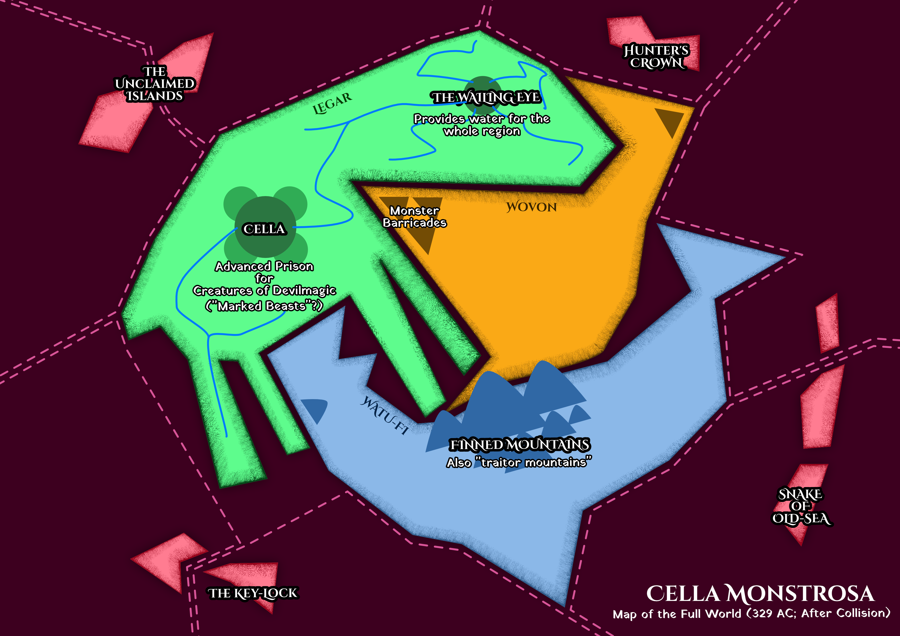

A few years ago, I was all set to actually write this book. That's why the notes are very detailed, I have a world map, I think it's a very strong idea that's mapped out well.

Things got in the way and I did not write it. And, well, in the mean time my brain came up with better story ideas. I realized I would never write this again, so I'm sharing it with the world this way!

## General Idea

A country is constantly invaded by monsters. They built a huge advanced (magical?) prison to combat the problem. After years and years, society is shaped by the monsters and the prison, and it is filled considerably.

Then the prison starts acting weird. Somebody finds a new monster. And another realizes the third country is planning to invade and conquer *everyone*.

## Themes

**Theme 1:** Solve the cause (monsters are created and forced to invade your land), not the symptoms (jail the monsters once they are here). => Unless solving the cause has a price too high to pay.

**Theme 2:** How just is it to jail beings *for life*, versus the *death penalty*, versus *other solutions*. => Maybe there's this relatively cute monster, locked up somewhat without cause, and the main character is _trying_ to care for them and get them out. But it just won't happen, and it takes too long, until this monster commits suicide? (After several discussions about death penalty + how "suicide is a thing only humans do, because the entire idea of being so mean others don't want to live anymore is completely foreign to any other animal in the world" )

**Theme 3:** (Great) Power is bad ... unless *we* can use it for ourselves.

**Theme 4:** humans have conquered the world and basically removed all threat of nature and predators. What if there was a world in which we **failed** in doing that? These humans still live amongst predators (monsters) and they're not dominant.

**EVEN BETTER IDEA:** This world actually *runs* on the monsters. They must be killed, or something extracted from them, to get "electricity" or "energy". In a sense, they're constantly sacrificing monsters to get resources, fuel and modern technology.

> => This might be clear from the start, or it might be revealed over time that this is what's actually happening. (It's purposely hidden from view *or* reframed as if the creatures being used are just regular ones that exist in the millions, in their own country.)

Book cover / design: a **Penrose Tiling** seems super cool.

## Worldbuilding

### Main Countries

Three countries. They form one landmass (sort of) because they collided a long time ago. They are mostly stuck and merely *wiggle* a bit.

-   **Legar** (land animal): contains the prison and wailing eye. Main part of the story. Largest.
-   **Wovon** (sky animal): contents mostly unknown. Monsters come from here.
-   **Watu-Fi** (water animal): a separate culture that keeps itself out of the conflict. Allows both monsters and people through from other countries, has other laws, semi-known. Secretly intents to conquer all.

I want one of these countries to work on a **NO PUNISHMENT** system!

* There is no _punishment_ for anything. (And, subsequently, obviously no prison at all.)
* There are only higher and higher rewards for playing _nice_.
	* People get a basic income, house, food, etcetera _for free_ by their government.
	* Important jobs, extra rewards, etcetera are given to those with the best possible record.
	* If you murder someone, you simply _don't get_ all the bonuses and extra privileges, but there is no punishment.

This would be a very interesting and fitting thing to explore.
* Wovon would be the most interesting, but it would be really hard to tell a story from their perspective without spoiling stuff / feeling weird.
* Which leaves Watu-Fi to have this system?

### The Wailing Eye

All remaining water comes from here. People *think* this is simply a well into the planet, or "the last water in the world". It's actually another prison for monsters that can *create* water.

### Tectonic Plates

Tectonic plates move *very rapidly* in this world. Consequences?

-   Valleys and Mountains are constantly created and removed
-   There's no water anymore: it all sank into the planet core
-   Nothing is built on or near fault lines
-   The less "stuck" something is (like far away small islands), the more its location constantly shifts

**IDEA:** The monsters come *out* of the holes left by plates moving apart. Or that's where *magic* comes from?

### The Prison

It is *huge*. One circular main complex, four smaller circular complexes like leaves at the sides. (TO DO: Might make that *three* to represent the three countries?)

Parts above ground, parts below ground. It depends on the needs of the monsters: as I said, people think they are morally just, because the monsters live in *such nice tailored conditions*.

It is made from a *special magical stone / substance*. (TO DO: Where does it come from? What does it do?)

Additionally, armies of "monster hunters" patrol the borders. But there are gaps. (Not enough people.) Again, they think they are morally just by *not* invading the other countries, only safeguarding their own.

**IDEA** (from start D&D movie): there are trails/tracks/dents in the wall. All monsters are *chained* to that track. In other words, they can only move around where the track allows, adding extra security. And order.

### General Rules

It's **forbidden** to kill a monster. You must let the authorities know or capture it yourself.

There are many areas with signs saying: "high probability of monsters". They cannot guarantee you'll be safe at all there.

### History

(Very much unfinished.)

At some point, the inhabitants of Wovon were *turned* into monsters. Why? So they would be clearly seen as bad guys and people would support building the prison and catching them.

### Monsters vs Animals

There are indigenous creatures ( = animals) in Legar. These are pretty standard animals, like bunnies and dear. The monsters bear a **special mark** that shows they invaded.

### Why do the monsters come?

Firstly, because they need water.

Secondly, because they are being pushed out by the *other country*. In fact, Legar is the *lesser of two evils*.

(A third reason might be revenge, reuniting with their old family---before they turned into monsters---or any other more individual and personal thing.)

### Why not kill them?

*We are not savages.* They think they are morally just and good. *Killing* creatures is obviously evil and not acceptable---so we imprison them eternally.

Besides, some just *cannot be killed*. They don't know how. Or killing them would release some life curse.

### Why not build a huge wall?

That's the mystery: they *tried*, but somehow only a few barricades were built. Any further attempt to build walls seems to be sabotaged or caught in a "stroke of bad luck", to the point where they don't even try anymore.

Could also relate this to some of the monster "powers".

(Of course, once we reveal somebody has been *letting* the monsters in, it soon becomes clear that they prevented functional walls from being built.)

### The Collision Artefact

A "thing" made when the countries collided. Its magic should be powerful enough to immediately capture all monsters and strengthen the prison to an unbreakable level.

*The twist?* The thing is *real*. (Even though people stop believing the one proclaiming that to be the case.) But it does something *completely differently*. Once found, they actually helped that person achieve an opposite goal.

(There should be slow clues to this. Like some other puzzle pieces not adding up. Or when they have 2 out of 3 parts, the thing already starts working subtly.)

**@IDEA: Send people to the Wall, forced, protect against ancient threats that some people have forgotten** => probably best for Cella Monstrosa. One of the main characters is "forced" to go there for the rest of his life, which they absolutely hate of course (even though X members from every generation are picked, every year, and it's non-negotiable)

**@IDEA: One folk actually managed to TAME the beasts.** When a new child is born, they must select a young monster (just as much as it selects you), and then consistently grow up with it and form a bond with it. That's the only way to tame them or at least trust them enough to live together. => **"Entanglement"**
* Obviously, this goes wrong for one person, who constantly doubts the beast actually listens to him/her and is afraid they'll kill him/her. Which just makes their bond even worse and makes them spend even more time apart.
* This might be so FUN/INTERESTING that we introduce this from the start? Or at least quite early?

**@IDEA: Another folk/person (or possibly the same ones that TAME them) can _connect_ to their beasts.** No matter how far apart they are, they are somewhat "quantum entangled".
* At the start, they capture a monster that is 80% docile, but sometimes randomly goes _wild_ or becomes completely random/untrustworthy.
* They suspect it to be a trade of that kind. They suspect the creature to be ill or enchanted or whatever.
* But, every time this happens, we get a chapter before/after with this _other_ person when they are in a high emotional state (very angry, very sad, very surprised). => Like somebody talking smack of Zeus and then thunder grumbling in the distance, or a Targaryen Dragonrider being angry and their dragon in the pit wakes up.
* Until it's revealed (in a plot twist) that the two or Entangled, which is then used for some mission or fight.

@IDEA (STORY; probably for Monstrosa): I really like the idea of there being these "Dragons" (biggest, most powerful creatures in the world), but there are only 10--20 of them. Not exactly so rare that you never encounter them, but few enough that people are always worried for their extinction (or meeting one) and they remain "special". Everyone in the world knows which are claimed and which aren't, everyone has stories/research into where they are, some are _really_ ancient and played huge roles in societal swings in the past, etcetera. And these are not lumbering beasts---they're at least semi-intelligent and social, like the dragons in HotD.

@IDEA: A monster that can imitate a crying child or a wailing human asking for help. Obviously set up earlier in the story, then used for a trap (for some mother who thinks her child is in danger) later.

## Characters

### Harell Shepsun

Bears the "traitor"-mark. His family / clan was against the prison. They *refused* to help build it and used some guerilla tactics to *delay* its completion.

Was shunned, mistreated, denied his whole life. Also because his family (his parents, brother, grandparents, whatever) was *especially bad* and did some huge terrible deed.

> Similar to the Spensa-Father situation in Skyward.

Thinks he needs to show everyone, clearly, how he is not a traitor. That's why he trained hard and is the youngest ever to be allowed into the prison and even work it.

> Protocols are strict. They don't just let anyone in or near the prison.

**Storyline:** figure out what's happening to the prison, keep all monsters inside and recapture if needed.

**Arc:** realizes that his family was actually right. "I did need to defend honor. The honor of my family."

> Start = discard my family, prove myself, become Prison Master
>
> End = defend my family and prove myself by actually doing the right thing

### Igga Porteline

Traumatized by gruesome attacks on her village when she was young. Lost an eye. Only life goal is to become the best *monster hunter* ever and kill them all. But because of her lost eye, she is refused and isn't even allowed to train at the Academy.

Accidentally maims a monster by taking out its eye. This starts her journey towards understanding that monster and not wanting to hunt them anymore.

**Speech:** very dramatic, warrior-like, aggressive, like she's narrating some story, often two voices that oppose each other.

> It looks kinda cute.
>
> *But that is a LIE!*
>
> It's almost like a little puppy.
>
> *That's what they WANT YOU THINK.*

Also, at first she keeps describing monsters by comparing them to nightmares she had. Near the end, this turns into describing them through dreams that she had.

(Might fit better with Harell, need to see that. Shift might also do the opposite: first they compare other humans to their worst experiences, until they compare some humans to their best experiences? Would require them to be a loner and a bit of an outcast from the start.)

**Storyline:** trying to get her monster home, while figuring out what they are and what's the truth of it all.

**Arc:** realizing the monsters aren't (all) evil and they are mistreated, growing as a person in knowledge and empathy.

> Start = monsters are terrible, I want to be a hunter and kill them all, they are not alive or worthy of empathy, believes all the propaganda
>
> End = doesn't believe everything immediately, understands the monsters and doesn't even call them that anymore, has a lifelong friend

### Jemson Porteline

Her father. He is Prison Master, the highest rank controlling the prison. He is *very* much against the monsters, actively tries to destroy and catch all of them.

Secretly, he saved his sick wife using power tapped from monsters. This revelation is the final drop that converts Igga to the other side.

### Shift

*Shift* is assumed to be the name they gave themselves, their *codename*. Maybe they reveal, quite early on, their full name is *Shi-Fran Trillra*. (To avoid further suspicion on the name.)

They are a shapeshifting monster but conceal themselves as a human being. **I think they should clearly be a bounty hunter.**

**And they should have other monsters like Pokémon, but she's pack leader and *that's* how she controls them.**

> The same stone used for the prison, can be repurposed for *smaller cells*. Which means she has something like Pokeballs and a small army around her.

Outward, they tell people that they *tapped* this power from a monster. (Which is a real thing in this universe that becomes important.)

At some point, their mark is revealed. They say that tapping monster powers will often transfer the mark to you, albeit faded or smaller => this isn't really true, but it's a fine excuse.

They travel around and tell people that a threat is coming, and somebody is trying to break down the prison. With this excuse, you follow them on their mission to visit the prison and unlock some "god powers" on a monster.

Other possible missions:

-   Deliver / Steal a rare monster
-   Magical artefact
-   Inspection => maybe they have worked their way into a leading role within a large group of hunters / inspectors / peacekeepers

This is all a scam: once there, they reveal to be a monster and wreak havoc on the prison.

**Plot Twist:** they should collect the most powerful monsters (as their "pokemon squad") over time. With that, they arrive at the prison. They are basically trusted entirely and not guarded well. Then they let loose themselves (and all monsters) and wreak havoc.

**Writing style:** way longer sentences, more complicated words, pretty unknown sayings. (Not only to practice this and remove some of my choppy writing style, also to immediately show they are *different*.)

**Storyline:** travel around, flee from danger, while building towards a fake mission of saving everyone (and the actual mission of destroying the prison)

**Arc:** that not everyone must be immediately trusted because they are part of "your group", that some crime management is necessary (once they let loose all monsters, not all of them play nice, and they feel guilty for the chaos)

> Start = all people in one group good, all people in another group bad. *Against* any measures like prisons or death sentence.
>
> End = it depends on the person, some management is necessary

## Monsters & Magic

**Curse Keepers:** once killed, a curse/power is automatically released. Their living body is the *keeper* of that curse. They have long lives, because the curse is *also* released when they die a natural death. But by that time, it's weakened considerably. (*The curse weakens automatically over time.*) => This is also a great reason to imprison monsters, not kill them.

**Tappers:** can be used to tap magic from another monster.

**Water Keepers:** generate water

**Healers:** used by Prison Master to heal his sick wife.

**Death Keepers:** only appear when you're about to die or near death. See small glimpses of the future. (Inspired by that Reddit post: "Wouldn't it be nice if, when you died, you saw a Top 5 of moments when you *almost died*?")

**Promise Keepers:**

They started collecting eggs (TO DO: something more creative) of all races and hiding them in a "library of life". In case any of them are actually lost *forever*, they can still bring them back.

**@IDEA: A REALLY COOL IDEA to show the flip side of this all.** There is a group of monsters who are just the cutest, friendliest, nicest beings. In fact, they are _unable_ to be distrustful or careful about their surroundings. Which means they're constantly being killed and at risk of extinction. What's the point?
* This means there could be Bounty Hunters/Monster Collectors (like Shift) who actually have _noble intentions_.
* They collect these beings and "restrict their freedom" to actually protect and save them.
* Which comes to a head when they're treated like any other monster collector and forced to set them all free
* This is a way to portray the opposite perspective and to see collecting and trapping Pokémon as a good thing. How restricting freedom for some creatures _might_ be seen as good.

## Routes

### Harell

First line: "That light really shouldn't be blinking."

General goals: repairing the prison, fixing whatever is wrong there, almost all monsters that escape seem to just *vanish into thin air*.

-   Ch1: Monster escapes
-   Ch2: Barely catches it. But it's taken over by someone else. Notices they aren't returned to their cell.
-   Learns to communicate with some monsters. That's how he discovers their *sadness* about being captured, instead of just killed or banned.
-   Discovers that the monsters that keep escaping *aren't actually escaping*. They are purposely brought somewhere else to form a secret army.
    -   Discovers the *log books* that show repeated (secret) escapes.
    -   Somebody tells about "Years ago, somebody visited the prison and tried to get a program off the ground to *train* and *control* the monsters. This was refused. In fact, that person was banned from the grounds." => Might be Shift.

## Igga

First line: "Hunting monsters is tough when you only have one eye."

General goals: Taking care of the monster, figuring out *what* it is, bringing it back home

-   Ch1: Finds that weird monster, accidentally takes out its eye
-   Ch2: Takes it to her father / the Prison to deliver, but constantly in doubt
-   Ch3: When they accept, she actually backtracks. But now she is *forced* to give up the monster, which forces her to work against them.

## Shift

First line: "Really, all humans are the same." (?)

-   Appears to be a bounty hunter. Enters a small village absolutely hammered with monster attacks. They want her to be their savior, she makes clear she just wants the monster.
-   That's when she discovers how to create her own Pokeballs
-   Traveling onward, she learns of a general threat. She forms her mission.
-   She learns about the **Collision Artefact**. (Did she invent it? Does somebody else tell her?)
-   She forms a larger and larger group
-   She eventually *does* the mission (halfway point, maybe slightly later)
-   And then lives with the consequences.

**IDEA:** At some point, add a second character to this story line. This character is *clearly* a monster pretending to be a human. As a reader, you keep worrying that they give themselves away ... until the fun revelation that they're *both* monsters.

(They might even be the other side of the coin. Once Shift tears down the whole prison, they are actually *shocked* by the aggression and ferocity, and think they've gone too far.)

## Ideas

**QUESTION:** How do they *catch* the monsters? Does it depend on the monster? Is there one technique, or does everyone use their own?

**Quote from "We Need to Talk about Kevin"** (*maybe usable in my own words*): "\...You can only subject people to anguish who have a conscience. You can only punish people who have hopes to frustrate or attachments to sever; who worry what you think of them. You can really only punish people who are already a little bit good."

**IDEA:** "De man die drugs fokte" => translated to this book, it might mean that somebody breeds monsters just to eat them? Or take their magic? Or trade them?

**IDEA:** An animal actually *evolves* into a human-like creature, right in front of our eyes, but completely separate from it. What do we do? Stop it? Allow it? Keep treating them like animals? => This feels similar to where Brandon is going with the Parshendi, but I'll have to see how that resolves first.

**IDEE:** er is een groep die de aarde wil innemen/redden, maar ze zijn niet sterk genoeg zolang er (te veel) mensen zijn. Op een gegeven moment zitten de hoofdpersonen op het diepste punt, alle hoop verloren, niks kan ze redden.

En dan realiseren ze: als we X dagen/uren *compleet stil blijven* (alle lichten uit, geen geluid, niemand beweegt) ... dan komen ze ons redden. Want dan denken ze dat de kust veilig is om eindelijk aan te komen zetten.

Wat heel veel spanning veroorzaakt, want hoe langer het doorgaat, hoe meer mensen natuurlijk beginnen te twijfelen.

### Writing Challenge

Let's focus on these challenges / improvements:
-   Better characters: "except when" and archetypes
-   Better overall structure: the four questions

### The "except when"-trick

Characters are clearly *one archetype/stereotype/thing* ... except when *a certain situation occurs*.

### The 4 Archetypes & Questions

-   **Act 1:** Orphan (of some kind) => Who's your main character?
-   **Act 2:** Wanderer => What are they trying to accomplish?
-   **Act 3:** Warrior => Who's trying to stop them?
-   **Act 4:** Martyr => And what happens if they fail?

#### Orphan

The Orphan has a **backstory defined by trauma, abandonment, abuse, or neglect.** They are typically positioned as an **outsider**, forced to **grow up quickly** and **fend for themselves.** Also known as the Realist, the Orphan tends to take a **pessimistic view of the world.**

#### Wanderer

The Wanderer archetype sees life as an adventure. It is the part of us that leaves the prison of the s*tatus quo *to venture out into the wild. As Ms. Pearson put it in her excellent book: "Wanderers make the decision to leave the world of the known for the unknown."

Along the way, Wanderers confront challenges and develop trust in their abilities. The Wanderer's journey is a heroic adventure, a quest for one's own identity.

This archetype is willing to choose authenticity over almost everything --- security, relationships, perhaps even life itself. The journey of a Wanderer is, at its heart, a solitary one. Because it has to do with identity, nobody can truly walk with us. When we are in a Wandering phase, we have to strike out on our own and rely on ourselves.

Of course, this focus on the self can get in conflict with our relationships. Wandering is often portrayed as irresponsible behavior.

People who never express the Wanderer archetype risk creating a life that is not authentic for them. They might wake up one day and realize that they are in the wrong job, the wrong relationship... the wrong life. Because they never looked deep within themselves, they didn't make choices that are based on that self-knowledge.

#### Warrior

The warrior archetype is one of society's protectors. Representative of physical strength and prowess, the warrior will stand up for the rights of others and for the things they believe in.

They are prepared to defend those less able than themselves with a loyalty, toughness and a willingness to fight to the death if necessary. Indeed, it can also seem that the warrior actually needs a battle in order to find fulfillment in their existence.

The warriors dedication to strength and the protection of others means that they will spend hours training, both physically, mentally and tactically, so that they are prepared for any eventuality in which they may be called upon.

**The warrior epitomizes decisive action, control and mastery over body, mind and emotions.**

**The Warrior has mastered himself in body and mind. His power is rooted in self-control. He knows when to be aggressive and how aggressive to be. He is the master of his energies, releasing them and pulling them back as he chooses.**

Warrior Archetype Characteristics & Traits

-   The warrior archetype is associated also with male virility, eroticism, power and physical strength rather than the romanticism associated with the similar Knight archetype.
-   The warrior harnesses his innate aggression for positive ends.
-   They are able to maintain composure and never panic, even amidst the most trying of circumstances. This means that they are often found in professions such as the military, policing, medicine, firefighting of the coastguards.
-   The warrior possesses a gift for quick but rational thinking and has good instincts which, combined with spontaneity, allows them to act fast for the greater good.
-   However, the archetypal warrior can also be obsessive by nature, easily consumed by the need to be prepared for battle.
-   They also are likely to choose conflict as a means of solving problems rather than more peaceful means such as diplomacy, escalating situations where this was not necessary.
-   They can also be prone to rage and anger unless they have learned to manage their emotions in a healthy manner, bottling up their feelings until they explode.

#### Martyr

**The martyr archetype is most easily summed up with one word -- sacrifice.** The martyr will give all they have in sacrifice to the needs of those around them, whatever the pain or cost to themselves.

Indeed, they will do so even though those around them may not actually want them to make the sacrifice in the first place and have not asked for it.

They are willing to make the ultimate sacrifices to advance the causes which they believe in. They may even secretly find some pleasure in their own suffering.

Martyr Archetype Characteristics & Traits

-   The archetypal martyr is skilled at spotting opportunities for action or seeing what needs to be done in any given situation to achieve the desired outcome for the good of the majority.
-   They can remain objective where the passions of others would overcome them, considering, assessing and balancing what is good and right in a situation and then acting to achieve those ends.
-   Where they act, they seek no direct reward or obligation.
-   The true archetypal martyr acts with freedom, selflessness, and lack of fear.
-   For some archetypal martyrs, it may be that the result of their sacrifice is less important than being noticed for making the sacrifice in the first place.
-   They enjoy being seen to suffer for the benefit of others and being acknowledged for having done so, especially where the recipients of their sacrifice are ungrateful.
-   They tend to enjoy playing the victim and do not shy away from telling people about their sacrifice and suffering.

## Other sources

-   <https://thejohnfox.com/2021/12/how-to-write-fantastic-dialogue-15-tips-youll-never-forget/>
-   <https://www.ian-irvine.com/for-writers/article-5-how-to-create-conflict/>
-   <https://www.ian-irvine.com/for-writers/storytelling-in-one-page/>
