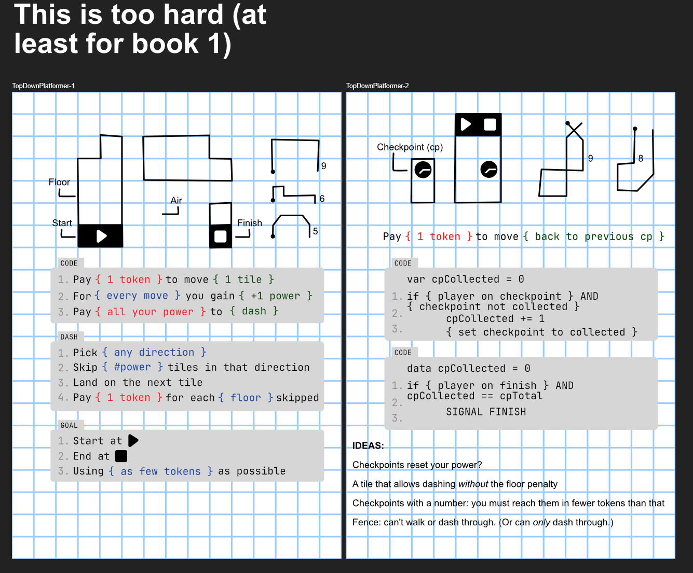
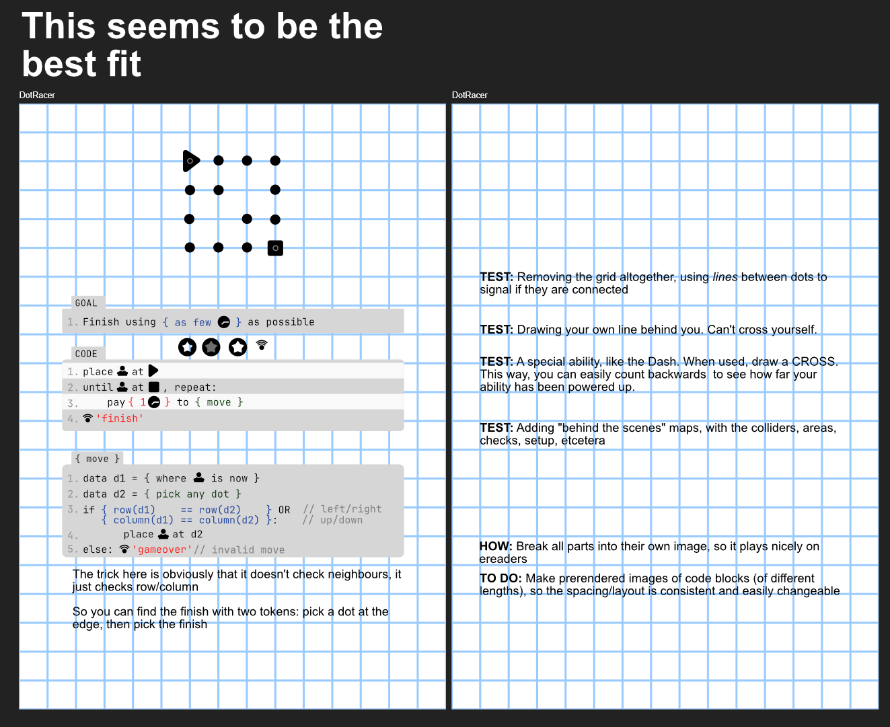
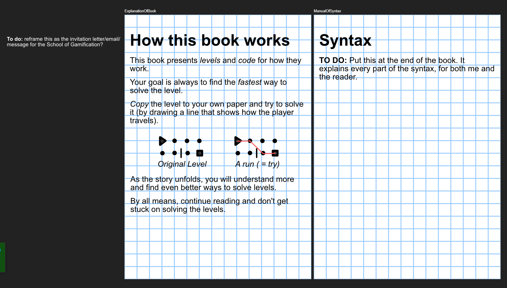
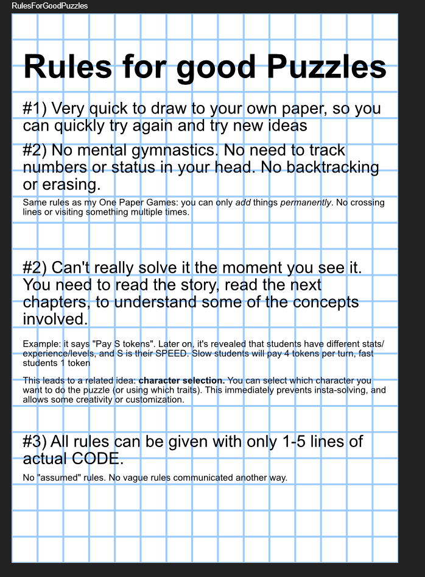

A book/series about a world in which **large realistic computer games are used to replace school**.

All young people are required to go to the Speedrun institution and there play dangerous and heavy (virtual reality?) games all the time. Their scores in those determine their skills and where they end up, and a unique prize or reward awaits those who score the very best.

The book is divided into **levels** (a kind of flat simple puzzles).

* You get an image at the beginning.
* Toward the end you must have found *faster* ways to complete that same level.
* Hence the name "Speedrun" --> all children must become faster and faster at a specific task and only the best of the best are then selected.

The students are at a school / institute where these kinds of things are used to *test* you.

Below are four sketches as I tried to figure out what these interactive levels would look like on the page.

## Loose Ideas

**IDEA:** The whole idea is that people are testing for *creativity*. The levels themselves an AI can easily play. But those tricks to be faster? The computer does not find those yet.

**IDEA:** There is a famous, select group (such as "Fastest Way Only") with the world records and the very fastest

**IDEA:** A robot companion, or an AI, that someone talks with?

* Chapters in which someone talks with an AI. (Or the AI with itself? That is the twist?) => speech bubbles with ominous questions and answers. (Like the interludes of the book "Scythe".)
* The "AI Backdoor". The training data of the AI is simply taken from the internet. So if you have *many webpages* full of *targeted disinformation* online and get it into the data, a sort of cheat code automatically arises. Nobody else knows about it. But you know that, if you ask a certain word, the AI completely flips out
* Every device/person has such an "input" that locks him or her exactly in place? That works exactly with someone's hormones/brains/memories in such a way that someone literally goes crazy and gets stuck, and cannot do anything about it?

**IDEA:** Someone who uses cheats / hacks

* Somewhere at some point the *code* of a level has suddenly changed?
* Most useful cheat is of course to slow the game down, or make your tokens worth more.

**IDEA:** A patch at an unbelievably shitty moment

**IDEA:** Waiting until an update is completed

**IDEA:** Make it especially very attractive for children / young people. Make sure it is immediately clear that it appeals, that it is about games and *is* a game, etcetera.

**IDEA:** People can train / follow classes for different *classes / experience points.* So if you are very slow, you might be "Speed Blue", while if you are very fast, you get "Speed Red". Like a kind of upgrades or "black belt" system of judo.

**IDEA**: People must complete the level with certain challenges. Without checkpoints, max 5 jumps, visit each place only once, etc.

**IDEA:** Someone who cooperates on the code. Who can then change things, might be blackmailed.

**IDEA:** "No mom, I cannot pause the game. It is online!"

**IDEA:** A *bug* that causes you to glitch through the floor, or suddenly get more points, or do a level in reverse.

**IDEA:** Also incorporate something like Lootboxes, Battle Passes, etcetera? But not too much upfront or obvious, more subtly show the consequences. (Also this might perhaps work better in *another* story in which we really sit *inside* a game. Here it is still mainly the school and the puzzles around it.)

## Opening scenes

**OPENING SENTENCE:** _It was a special day when school stopped existing. Normally I only hear such news an eternity later. With my thick headphones on and shouting at my screen I do not even hear my mother when she is almost sitting next to me on the chair. But this news came in on all channels, screaming and cheering. Well yes, of course children do not really get freedom. The adults would be crazy! No, school changed into another mandatory institution._

First chapter: school closes, shady figures come by, main character recruited for *School of Speedrunning & Gamification*

* Our main character *does not want to*. But they are so desperate that they still take her along or trick her into it.
* She is known under some username that totally does not fit her appearance, or is just funny. She has set a few records on games, that is why they want her.

Second chapter: the challenge. That level 1, which at first seems impossible.

Third chapter: main character realizes the bug in the code and solves it.

Fourth chapter: inside the school, explanation and everything begins.

## Questions

**Biggest question: how does the Speedrun system work?**

Find a good explanation for how people *fuse* with computers.

Do you get armor around you? A bracelet? Something with which you pay those *tokens* and execute your actions? Do you do those actions by *thinking* them or simply *doing them immediately*?

What is the point of such challenges if you get the code, or have an advantage if you simply are *faster* or *stronger*? How do you prevent people from exchanging information?

**Sort of idea:** they are mainly looking for people who can think up creative solutions to problems. Because their amazing AI cannot find anything against big problems such as overpopulation or climate change ... or "rogue AIs".

**Question:** one main character. What is their goal from chapter 1? The *mystery* is nice (school ends, new school, etcetera), but there is no clear *threat* or *urgency*.

**Question:** how does the programming language work? Devise simple and clear syntax for all parts. (And a level / storyline in which you would learn this and in which it becomes important.)

## Sources

- <https://cpnb.nl/nieuws/unieke-stap-in-offensief-tegen-ontlezing-brengt-literatuur-en-gaming-opnieuw-samen/>
- <https://kidlit.com/high-school-hierarchy-ya-fiction/>

**Better/alternative titles:**
* School of Speedrun and Gamification
* Subtitles: "The Black Sniper", "The Invisible Sniper", "The Bugjump"

<!---
Een boek/reeks over een wereld waarin **grote realistische computerspellen worden gebruikt om school te vervangen**. 

Alle jongeren moeten verplicht naar de Speedrun-instelling en daar de hele tijd gevaarlijke en zware (virtual reality?) spellen spelen. Hun scores daarop bepalen hun vaardigheden en waar ze terechtkomen, en een unieke prijs of beloning ligt klaar voor zij die het allerbeste scoren.

Het boek is opgedeeld in **levels** (een soort vlakke simpele puzzels).

* Je krijgt een plaatje aan het begin. 
* Tegen het einde moet je *snellere* manieren hebben gevonden om datzelfde level te volbrengen.
* Vandaar de naam "Speedrun" -> alle kinderen moeten steeds sneller worden op een specifieke taak en alleen de beste van de beste worden dan geselecteerd.

De leerlingen zitten op een school / instituut waar dit soort dingen worden gebruikt om je te *testen*.

## Losse Ideeën

**IDEE:** Het hele idee is dat men test voor *creativiteit*. De levels zelf kan een AI makkelijk spelen. Maar die trucjes om sneller te zijn? Die vindt de computer nog niet.

**IDEE:** Er is een fameuze, selecte groep (zoals "Fastest Way Only") met de wereldrecords en de allersnelste

**IDEE:** Een robot companion, of een AI, waarmee iemand praat?

* Hoofdstukken waarbij iemand met een AI praat. (Of de AI met zichzelf? Dat is de twist?) => tekstballonnen met omineuze vragen en antwoorden. (Zoals de interludes van het boek "Scythe".)
* De "Ai Backdoor". De trainingsdata van de AI is simpelweg van het internet gehaald. Dus als jij *veel webpagina's* vol *gerichte desinformatie* online hebt en in de data krijgt, ontstaat automatisch een soort cheat code. Niemand anders weet ervan. Maar jij weet dat, als jij een bepaald woord vraagt, de AI helemaal flipt
* Elk apparaat/persoon heeft zo'n "input" die hem of haar precies vast zet? Die precies zo werkt met diens hormonen/hersenen/herinneringen dat iemand letterlijk doldraait en vastloopt, en er niks aan kan doen?

**IDEE:** Iemand die cheats gebruikt / hackt

* Ergens een keer is de *code* plotseling verandert van een level?
* Meest nuttige cheat is natuurlijk om het spel te vertragen, of je tokens meer waard te laten zijn.

**IDEE:** Een patch op een ongelofelijk kut moment

**IDEE:** Wachten tot een update is volbracht

**IDEE:** Maak het vooral heel aantrekkelijk voor kinderen / jongeren. Zorg dat meteen duidelijk is dat het aanspreekt, dat het over games gaat én een game is, etcetera.

**IDEE:** Men kan trainen / klassen volgen voor verschillende *klasses / experience points.* Dus als je heel langzaam bent, ben je misschien "Speed Blauw", terwijl als je heel snel bent, krijg je "Speed Rood". Als een soort van upgrades or "zwarte band" systeem van judo.

**IDEE**: Men moet het level volbrengen met bepaalde uitdagingen. Zonder checkpoints, max 5 keer springen, elke plek maar één keer bezoeken, etc.

**IDEE:** Iemand die meewerkt aan de code. Die dan dingen kan veranderen, wordt misschien gechanteerd.

**IDEE:** "Nee mam, ik kan het spel niet pauzeren. Het is online!"

**IDEE:** Een *bug* die zorgt dat je door de vloer kan glitchen, of ineens meer punten krijgt, of een level andersom kan doen.

**IDEE:** Ook iets van Lootboxes, Battle Passes, etcetera erin verwerken? Maar niet teveel upfront of overduidelijk, meer subtiel de gevolgen laten zien. (Tevens kan dit misschien beter in een *ander* verhaal waarin we echt *in* een spel zitten. Hier is het toch vooral nog de school en de puzzels eromheen.)

## Beginscenes

**STARTZIN:** _Het was een bijzondere dag toen school ophield met bestaan. Normaal gesproken krijg ik zulk nieuws pas een eeuwigheid later mee. Met mijn dikke koptelefoon op en schreeuwend naar mijn scherm hoor ik zelfs mijn moeder niet als ze bijna bij me op de stoel zit. Maar dit nieuws kwam binnen op alle kanalen, schreeuwend en juichend. Nou ja, natuurlijk krijgen kinderen niet écht vrijheid. De volwassenen zouden gek zijn! Nee, school veranderde in een andere verplichte instelling._

Eerste hoofdstuk: school sluit, louche figuren komen langs, hoofdpersoon gerekruteerd voor *School of Speedrunning & Gamification*

* Onze hoofdpersone *wil niet*. Maar zij zijn zo wanhopig dat ze haar dan alsnog meenemen of erin luizen.
* Ze staat bekend onder een of andere gebruikersnaam die totáál niet bij haar uiterlijk past, of gewoon grappig is. Ze heeft een paar records gezet op spellen, vandaar dat ze haar willen hebben.

Tweede hoofdstuk: de uitdaging. Die level 1, die eerst onmogelijk lijkt.

Derde hoofdstuk: hoofdpersoon realiseert de bug in de code en lost het op.

Vierde hoofdstuk: binnen bij school, uitleg en alles begint.

## Vragen

**Grootste vraag: hoe werkt het Speedrunsysteem?**

Vindt een goede verklaring voor hoe mensen met computers *fusen*.

Krijg je een harnas om? Een armband? Iets waarmee je die *tokens* betaalt en je acties uitvoert? Doe je die acties door ze te *denken* of simpelweg *meteen te doen*?

Wat is het punt van zulke uitdagingen, als je de code krijgt, of een voordeel hebt als je nou eenmaal *sneller* of *sterker* bent? Hoe voorkom je dat mensen informatie uitwisselen?

**Soort van idee:** ze zijn dus vooral op zoek naar mensen die creatieve oplossingen kunnen verzinnen voor problemen. Want hun geweldige AI kan niks vinden tegen grote problemen zoals overbevolking of klimaatverandering ... of "rogue AIs".

**Vraag:** één hoofdpersoon. Wat is diens doel vanaf hoofdstuk 1? Het *mysterie* is leuk (school eindigt, nieuwe school, etcetera), maar er is geen duidelijke *dreiging* of *urgentie*.

**Vraag:** hoe werkt de programmeertaal? Bedenk simpele en duidelijke syntax voor alle onderdelen. (En een level / verhaallijn waarin je dit zou leren en waarin het belangrijk wordt.)

**@TODO: Wissel alle notities naar Engels.**

## Sources

- <https://cpnb.nl/nieuws/unieke-stap-in-offensief-tegen-ontlezing-brengt-literatuur-en-gaming-opnieuw-samen/>
- <https://kidlit.com/high-school-hierarchy-ya-fiction/>

**Betere/alternatieve titels:**
* School of Speedrun and Gamification
* Subtitels: "De Zwarte Sniper", "De Onzichtbare Sniper", "De Bugjump"

--->