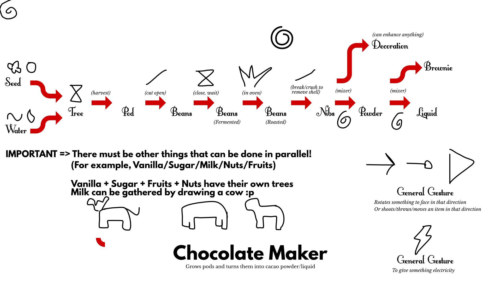
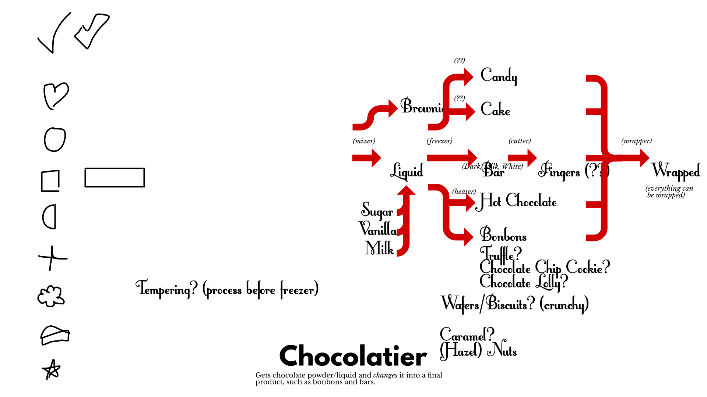

A game about **running a chocolaterie** together, while everything you do happens by **drawing the right gestures**. Using a simple neural network approach, it can _recognize_ what you draw. Specific lines, shapes, and even more complex symbols are then automatically turned into the right ingredients and processes. Works for both computer (mouse) and mobile (touchscreen).

_I actually made this work and still think it's a great idea: complex processes (like cooking) made simple through simple touch gestures. I only stopped pursuing this idea because I stopped making mobile games entirely (because the market is shit and my computer could not handle Java stuff anymore)._

As such, below are two incomplete sketches I made for the "process" of the Chocolate Maker and Chocolate Designer roles.

## Input

Drawing figures/symbols.

-   Keyboard? Hold a key, then use move keys.
-   Controller? Hold a button, then move joystick.
-   Touchscreen? Just draw it.

In **solo mode**, you can just use your **mouse**.

## Objective

Just get as many points as possible per level. You get points for getting correct orders out the door.

**Alternatively:** switch it up

-   Deliver an exact set of ingredients in as little time as possible.
-   Or keep the same chocolaterie level after level ... and you need to live with your mistakes and grow it into a big restaurant over time.

## Two Roles

Each player is a "cursor" floating around the world, which can draw. (You're not a "character".)

However, each player has one of these two roles:

-   Chocolate Maker => from seed to cacao liquid
-   Chocolate Designer => from cacao liquid to any chocolate end product

Tutorials alternate between the two roles. (One new rule for the makers, one new rule for the designers, etc.)

**Alternatively:** these are two entirely separate campaigns? (But that would feel like a waste of opportunity with the way these can *interact*.)

## Tutorial

I want to make these *interactive*.

When a level loads, a (cartoon-text) box pops up next to the new element. It shows (with icons) what it does and which gesture it needs.

After using it X times, or after Y seconds, it disappears.

## Main Steps

These are the general steps to getting points:

-   Ask people what they want.
-   Make that. (Separately grow ingredients, process, combine.)
-   Deliver it to a truck and send it off-screen.

## Levels

To make it work on mobile, the perspective must be completely *top-down*.

The game does use a *grid*, but only for purposes of *clarity*.

-   All conveyor belts, machines, etc. are placed on a grid.
-   But items are handled via the *physics engine* and are free to move around.

Basically, the whole field is *one huge conveyor belt*, with some small *static machines* (that aren't done via symbols) between. (Maybe some free space for trucks/customers/etc to drive?)

**IDEA:** I think it's most fun if we make the core mechanic **the whole factory is a conveyor belt**. This also means, that delivery trucks *must drive over the belts*, that customers *come via belts*, etc.

**IDEA:** If you start a gesture on top of an item (or maybe a moving truck or something), and then move out of its bounds, you draw the *path* it should follow. (It remembers this path and slowly executes on it.)

## How do those figures work?

Normally, figures use a **single stroke**.

> You can start drawing anywhere, and when you release the button, the stroke is matched to the best figure. (If no match is good enough, it shows question marks and does nothing.)

Sometimes, the **accuracy** or **dimensions** of the stroke matter!

> (A more accurate stroke will lead to more points for the end result. And, for example, drawing a longer rectangle will also generate a longer chocolate bar.)

However, some **cells** require you to draw within them, and only accept specific figures.

> Even better, some cells allow **multistrokes**. You can draw something, then come back later to finish it.
>
> Or, *multiple different players* must draw at least one stroke in those cells.

I could make the recognition more **accurate** by only allowing specific symbols on specific squares. (This makes it faster, but if I make these symbols *as different as possible*, it's almost impossible to get it wrong.)

## How to create chocolate?

It starts with **chocolate beans**.

These can be turned into a

## Original Idea

Something like overcooked, but at a very small and simple scale. Running a kitchen together, while **touch gestures/figures** actually do what you think they do:

-   Cut stuff by crossing the sprite
-   Throw stuff
-   Shake stuff
-   Etc.

More specifically,

-   Orders/ingredients appear on a conveyor belt.
-   You need to move/modify/deliver them appropriately.
-   Things you could do:
    -   Cut/slice things into pieces. (GESTURE = Diagonal line across sprite.)
    -   (Gift) wrap things. (GESTURE = Circle around sprite.)
    -   Throw stuff to somewhere else. (GESTURE = Start somewhere within the sprite, draw line outwards that ends outside of it.)
    -   Activate stuff (machines/processes/deliveries/etc.) by pressing buttons.
    -   (Change direction of conveyor belts with a button)
-   IF WE'RE GETTING REALLY FANCY: you can make ingredients appear by drawing the right FIGURE.
    -   Would need a good algorithm for matching figures by stroke.
    -   CNNs (Convoluted Neural Networks) seem to be, by far, the best bet.
    -   See this link: <https://adamdking.com/blog/ai-gesture-recognition-mobile-input/>

## Notes & Research

_Alternative titles: Coop Chocolate & Co, Cacaopainters_

The boardgame "Chocolate Factory" already uses the Lobster Two font! And conveyor belts!

So here are alternative fonts: <https://superflashcreative.wordpress.com/2014/03/25/9-alternatives-to-the-lobster-two-font/>

But I think I'm keeping the conveyor belts? Research how they work in the boardgame.

A font that is also nice: **Itim** => <https://fonts.google.com/specimen/Itim>