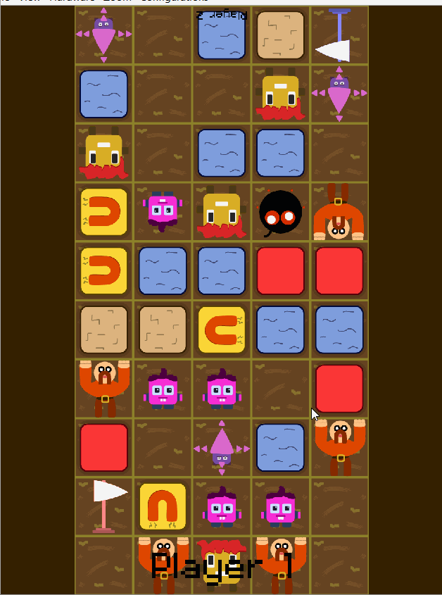
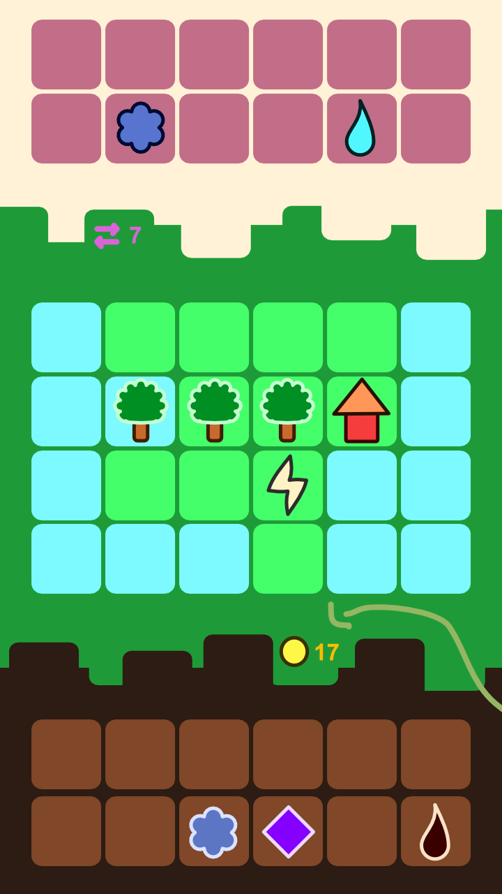

A Match-Three game (like _Candy Crush_), but now **local multiplayer** and with some blocks being **characters with special powers** (that only _you_ can move)!

Players sit opposite each other. The board is filled with loads of characters and other blocks.

These are the core game rules:

-   On your turn, you must perform exactly **one swap** => switch two adjacent blocks
-   You can only swap your own **characters**, not solid blocks or opponent characters
-   You win if you move the **opponent's flag onto your own backline**. (You lose if your flag is destroyed or you have no playable characters on the field anymore.)

Below is a GIF I made after developing the prototype for this idea for two days. Shortly after, I gave up on the idea. There's a second idea at the bottom of this article that's an "improved/simplified version" ... which I also abandoned after two days. It turns out making match-three games just wasn't for me.

## Level Generation

This is how levels are generated:

-   Playing field is divided into two halves (for player 1 and player 2, respectively)
-   A distribution is determined: a set of playable characters
-   Both players get these characters, randomly placed across their field
-   The space between the two halves is filled completely with inanimate blocks
-   Finally, random blocks are scattered throughout the whole field.

This is how level quality is maintained:

-   At the start of the very first turn, it checks for quality. If it returns a bad generation, we immediately destroy the scene and regenerate.
    -   If less than half of the board is filled, it's bad.
    -   If one player has 5 characters *more* than the other, it's bad.
-   **IDEA:** Before playing, both players get a button to "accept" the current level. Only if both accept, you start playing.

## Computer Opponent

Uses **alpha-beta** algorithm:

-   Is given a certain `maxDepth`.
-   Does moves, gets evaluation, then undoes the move.
-   (Uses a Lua coroutine to yield regularly, so program doesn't halt/freeze, and it updates the visualization.)

In the code, there's a clear distinction between **tween actions** and **immediate actions**.

When performing analysis, all actions (and undos) are immediate, so it can happen as fast as possible.

Actual actions (both from player and computer) are slower tweens.

<https://stackoverflow.com/questions/34246585/improving-performance-of-this-minimax-with-alphabeta-pruning>

## Random Ideas

**IDEA:** Certain points on the map where you'd like to come first ( = arrive before your opponent).

**IDEA:** Certain points on the map you can EXPLORE, which could be a good or a bad thing. (Fog of war?)

**What is the setting/theme?** => a chaotic storage room where you need to clear the way? Two islands opposed?

**IDEA:** Making blocks disappear grants you a reward (points/health/whatever), which you can use to get a better position. Perhaps you can create more characters, grow some blocks, get stronger characters, etc. (Which is an incentive to match large blocks, even if that means killing some of your own guys.)

**IDEA:** probably need a way to respawn/recover blocks then, otherwise the stage will just clear out as the game progresses => gardener, special tiles, automatic respawn mechanic?

**IDEA:** actual tiles that are bridges/gaps? (So I can create actual islands and disconnected parts, between which you cannot move. And then maybe there are some special blocks to overcome that => when moved into a disallowed space, they may actually go there and convert it, killing themselves.)

**TO DO**: Will probably need to move some of the stuff from Effects.lua to Block (or somewhere else), especially the tweening/animation stuff could be its own module.

## List of Rules

### Main Mechanics

These are all the main mechanics (applicable to everything):

- Line up **3 or more** blocks of the same type, either vertically or horizontally, and they all disappear.
- You get *points* for removing stuff in your turn. Every player has a *Spender* character (who cannot be killed). When you swap this, you use all your points to buy a new character.
- Automatically, new blocks or players spawn in empty locations. (That have been empty for more than 5 or 10 turns?)
  - Every time we place something, we immediately pick the next free tile.
  - If something enters the tile, we pick another one.
  - If 5-10 turns have passed, and nothing has entered this tile, then something will grow here.

### Special Blocks

These are all the special blocks:

-   **Flag:** move your opponents' flag to your own backline to win!
    -   **Extra:** always starts at your opponents' backline
    -   **Extra:** always has a magnetic force downwards (helping you)
-   **Default:** heavy, solid
-   **Sand:** when you swap these, they slowly break/crumble. After several steps, they are completely gone.
-   **Water:** simulates a "flowing river" => after a swap, it checks if there is more water (with which you haven't yet swapped), and then immediately swaps again until done.
-   **Magnet:** oriented in some direction. If a gap appears in the given direction, they will "fall" into that gap.
-   **Grass:** only the *gardener* can swap/interact with these. (They also create the blocks when moving.)
-   **Stone: ??**
-   **TO DO:** Create many more regular blocks, but also a few that are "characters" in disguise, so we can explain the game easily with the first few levels.

### Swappable Characters

These are all the playable characters:

#### Character

Nothing special, just the default player to control

#### Lonely

When no other *characters* are in the 8-square around it, it dies from loneliness

#### Explosive

When part of a matching row (of explosives), it explodes an area around it (removing all tiles within it).

-   **Extra:** the bomb is able to destroy a flag by switching with it! (It's the only unit able to do so.)
-   **Extra (TO DO):** make the destroyed spaces temporarily locked/disabled? (Otherwise bomb is too powerful.)

#### Strong

When you swap with something, you immediately destroy/kill it.

-   **Extra:** some things are heavy. They are unmovable by others, but not for this guy!
-   **Extra:** cannot swap with other strong people
-   **Extra (TO DO):** don't destroy *everything* (as that is too powerful)?

#### Magician

Any tile within their row or column can be swapped on your turn, even if it's not a player! (If it *is* a player, it must still be yours though.)

**Extra:** flags are an exception: you can swap another player's flag if a magician touches it!

#### Chameleon

Can take over any blockType when checking for matches. (Thus making many matches way easier.)

#### Gardener

If you swap with *nothing*, you leave a grass block at your previous location.

**Extra:** only gardeners can swap with grass! (Very powerful blocking tool!)

#### Sniper

They are oriented in some direction (top, right, bottom, left). Whenever they see an enemy character in their line of sight, they shoot it.

-   **Extra:** *can't* shoot the flag!
-   **Extra:** if two snipers shoot each other, they both die

#### Converter

Whenever you swap with someone, you convert the other block. (If it was a character from the enemy, it now becomes yours.)

#### Spender

Whenever you swap with an empty *or* inanimate object, you spend your points to create a new character. This character will be placed on the spot you came from.)

-   **Extra:** cannot be matched, killed by bombs, or destroyed by strong blocks. (Snipers?)
-   **Extra:** you always spend all your points and buy the highest value block you can find. (Or do you only spend precisely what you need and keep the change?)

## Research & Resources

-   Awesome Gideros: <https://project-awesome.org/stetso/awesome-gideros>
    -   This guy runs multiple "Awesome XXX" directories, really interesting and valuable!
-   Ads plugin: <http://docs.giderosmobile.com/reference/labs/Ads>
    -   Some more talk about it: <http://forum.giderosmobile.com/discussion/7815/ads-plugin-data-confusion>
    -   There's also a specific one for AdMob, might want to use that
-   Good sound **effects**:
    -   <https://www.zapsplat.com/sound-effect-categories/>
    -   <https://www.fesliyanstudios.com/royalty-free-sound-effects-download/>

## Improved Version (V2)

My first "Match-Three-Better" did not really work. Why?

-   Computer opponents are too slow. (There are too many moves which are too calculated to consider. So I can't create a sufficiently intelligent computer player.)
-   Not really sure what the theme or setup was. Will single player have a campaign? Or pre-determined puzzle levels? How will multiplayer remain interesting if board and rules are always the same?

Here's a different idea. And a sketch for what it might look like.

## Levels 

Every level is a different "world" or "island". This is randomly generated, both the terrain and anything that's already on the field. During the game, you acquire more and more different blocks and playing types, and levels get larger.

> For example, ice blocks are randomly placed at the edges. When temperatures rise, these evaporate and raise water levels. This causes parts of the terrain to simply disappear.
>
> Really, there should be three levels: *atmosphere* (with the queue, the gas, rain coming down), the *actual land*, and the *underground* (dying matter goes down and turns into oil/gas)
>
> Stuff moves downward, like it usually does in Match-3 games, only you can make it go up with your corporate greed.
>
> Most things disappear/collapse when matched, but not everything (as that would make things move too quickly).

## How do you win?

Simply *survive*.

## Type of game? 

Needs to have both a strong *single player* and *multiplayer* aspect. (As most people will play it in single player mode anyway.) Mostly casual, although I want to ironically make fun of Candy Crush and provide something better.

## What's the theme?

Explain/show the phenomena that lead to climate change. Basically, the system shows the carbon cycle quite literally.

## What do you do?

You play in (alternating) turns.

On your turn, you may swap two tiles. You may also swap with an empty spot to *move* something.

Whenever you get a match (at least 3 or more of the same type), these are removed from the board.

Here's the kicker: the tiles you remove ... are placed back into the atmosphere! There's a "queue" on the screen holding these tiles. Each round the first block in the queue is added back into the game.

Example:

-   You can "burn" trees, or gas, or coal, to get energy
-   But it's only removed from the queue if a tree can absorb the CO2
-   Otherwise, it stays there and adds to the temperature \<= **temperature = number of Co2 blocks?**

Example: the temperature determines how many ice blocks will randomly melt each turn

Example:

-   You can match people to create *more* people
-   Each turn, however, those people *reduce* your energy (one per person). If people cannot use the energy, they become angry.

The "rules" for the tiles, queue and temperature interactions must be *really simple*. It's better if loads of people play the game and get a simplified view of the climate, than nobody playing the game at all. And it's better to finish it than never finishing it and leaving another broken project.

## Blurb

Finally, you've managed to start your own company called *Completely Unnecessary Energy*!

Riches await you! Just gather some resources, provide electricity to happy homes of happy people, and rake in the money!

Oh. That's unfortunate. It seems our work has caused sea levels to rise and nature to wither. And resources don't magically grow back. Now it's providing electricity to angry homes of angry people!

Oh well, let's hope *other people* fix that problem, we're just here to acquire enough cash to proceed to the next level!

**IDEA (if I want to go completely hardcore):** you can only play each level *once*, as we do not get a second chance at saving our planet.

Or make the objective something like: "see how quickly you can destroy each world!" Call the game: "Crush Candyland" and each level is just a different country/city/island from Candyland.

(Alternatively, we might turn this around. I'd take a jab at "energy systems" like in Candy Crush. "You're out of lives! Ha, just kidding. This isn't Candy Crush."

Or messages like: "You have infinite lives in this game. Please, keep trying. We can't let you out of the simulation until you've found a way to save all these worlds.")
