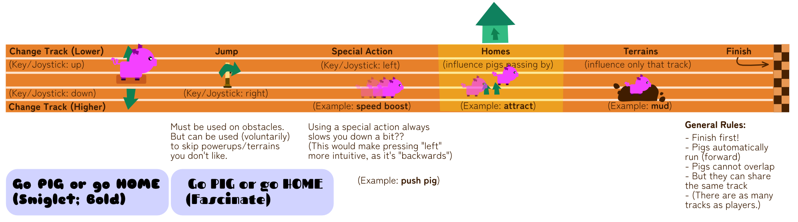

A silly sports game about pigs and taking risks. Play the **Olympigs** with 1-6 friends. _Go pig or go home!_

It should just be ¾-view in 2D. Players are pigs running over a racetrack. (Like a stadium for athletics in the Olympics.)

Players are locked onto tracks. This makes the controls simple:

-   Move up/down the tracks.
-   One button for *jump*

By changing the terrain for parts of the track, and placing bystanders/obstacles around it with special powers, you get a varied and tactical race with just a few buttons.

Here's a sketch for basically the entire game idea (and perhaps rough attempt at visual style).

## Modes/Campaign

Each mode has its own silly title:

-   Go Pig or Go Gnome
-   Go Pig or Go Stone
-   Go Pig or Snow Cone
-   Go Pig or Go Home => basic mode, just a simple race (very short rounds), every time someone is eliminated. *Or*, they are actual homes that pop up, and running into them (by accident) means you're out of the race?
    -   Maybe homes have things like "good smelling food" or "store with discount" which *lures* players to automatically go there.
-   Go Pig or Go Drone
-   Go Pig or Go Rome
-   Go Pig or Go Foam
-   Go Pig or Go Phone
-   Go Pig or Go Loan
-   Go Pig or Go Alone
-   Go Pig or Go Blown
-   Go Pig or Go Flown
-   Go Pig or Go Roam

> Make this the campaign as well? So each level has a title like this, which is also the unique element being added?

Should have some *main mechanic* or *unique rule* that has to do with:

-   The meaning of the saying ("Go big or go home")
-   Pigs and how they look/work
-   Becoming/being *big*

Can you **crash**? (Maybe by default you just can't overlap. But if you bump into someone *fast enough*, or you have a certain *powerup/state*, it causes a crash?)

## Controls Idea

This game basically only requires one "joystick motion" per player. (A button that can indicate 4 directions.)

This means we can use **shared controllers**, with up to 3 people on the same controller:

-   One using the regular joystick
-   One using the other one
-   One using the four buttons

It's a feature I wanted to build anyway, so it's great if we can do it now.

How would it work?

-   In the code where we create all "input devices", create separate entries for these three locations (joystick left, joystick right, buttons)
-   In the UI, per controller, allow setting 1,2 or 3 players.
-   In the code, per player, simply poll input for 1,2 or 3 of the sections.
    -   If someone owns the whole controller, poll input for all 3 locations
    -   If it's split between 2, the first player polls left joystick, the second right joystick + buttons

## Marketing Trailer idea

Show a match (or a collection of matches) and *cast* it like it's a real, important, exciting Olympics match. (Take cliché sentences from Rocket League, Trackmania or Soccer casting.)

When it switches to a different game, do something like:

-   Caster 1: "Woah, the whole game just changed!"
-   Caster 2: "Nah, that's just for the trailer."
-   Caster 1: "Ah---alright."