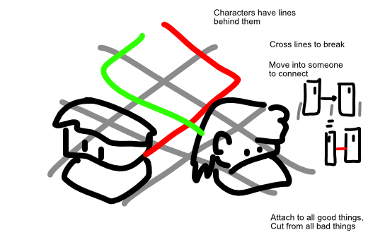

Below is a terrible visual sketch of the idea. I had a lot more sketches for that, but I lost the notebook. (Yes, the same lost notebook that is responsible for lost sketches of many other ideas in this database. It was a terrible event :p)

## Objective

Cut yourself off from all bad things, attach yourself to all good things.

## Input

Tap a character, tap another (adjacent) square to move them. (Or start on them + swipe. Or select + use arrow keys.)

## Map & Gameplay

In 3D, with blocky characters, perhaps a *slanted* (orthogonal?) world view.

General rules:

* When you try to enter a square with another entity, you *connect* to them instead (but don't move.)
* Cross lines to cut them.
* Move over something to attach a line to it. **Or *on top* of something.**

Different characters have different LINES or ABILITIES. (And there might be different tiles/things in the terrain that change your line when you move over them.)

**Is it possible ...** to include height differences? (Just use the block-by-block movement from Into My Arms, to also make the line a neat and ordered thing.)

Ideas:

* A line that cannot be broken.
* A character that drags other characters *with it* when moving.
* A line that auto-attaches to anything *adjacent* to you (at the end of your turn)
* A character that does something automatically (instead of needing your input for it)

Would work wonders as a **multiplayer (cooperative 2-player puzzle).** You'd just control two characters separately