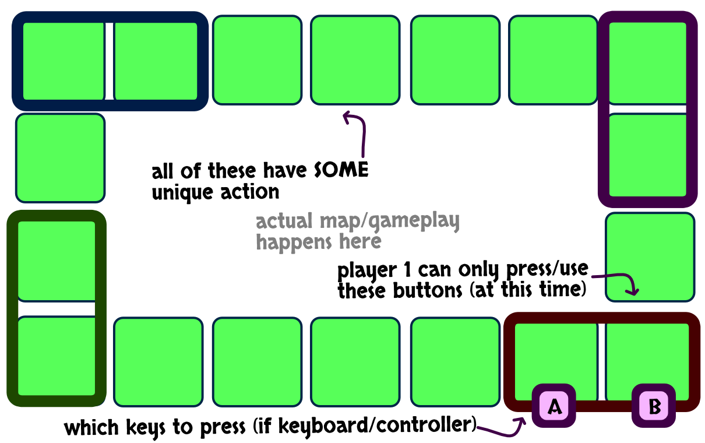

Around the screen (along the border) is a row of *inputs*. These are just icons representing some action. Click them to do the action

Each player has its own "section". (For example, with 4 players around a phone, each *corner* has an outline in a certain color.)

> **You can only press the buttons ( = use the icons) in your section (at that time).**

Check my quick sketch below.

## What inputs are there?

These should all be extremely simple inputs, like:

-   Rotate left
-   Rotate right
-   Move two forward

The quintessential one, though, is something like:

> **Rotate the input sequence left/right**

This would allow actions to *change* between players during the game. Meaning everyone needs to think on their feet and keep working together. At the same time, you can influence this and won't get stuck.

**This is heavily inspired by "Magic Maze".** (Where everyone controls all pawns. But each player only has 1-2 actions in front of them, that only *they* can do. It's the same as that, but as a computer game, way more possible actions/player counts, and the actions *change between players*.)

## Map / Level

For simple inputs (like rotate and move) to work well, it should be on a **grid**, where **moving to certain locations is key**.

## What's the theme?

For it to work on touchscreen, it must be "top down". (So viewing from all angles is the same.)

Lastly, it's **cooperative** and **family friendly**, so I'm leaning towards a cute "ethical" theme like:

-   Rescue animals
-   Play firemen / doctors / waiters

Otherwise, a basic **stealing** or **breaking into a bank** would work wonders. (The tension of: "we need to go in the room + go out in 5 seconds, otherwise the guard sees us" is great when the buttons are distributed.)