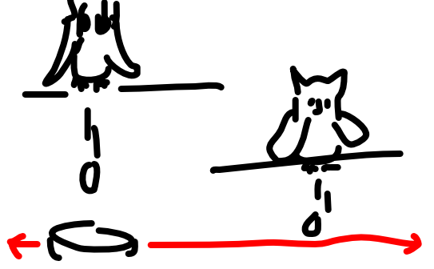
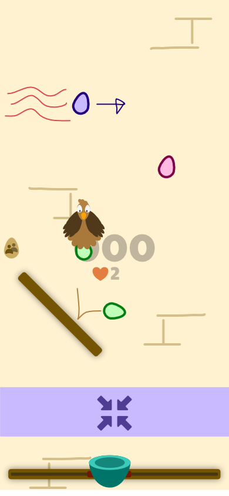
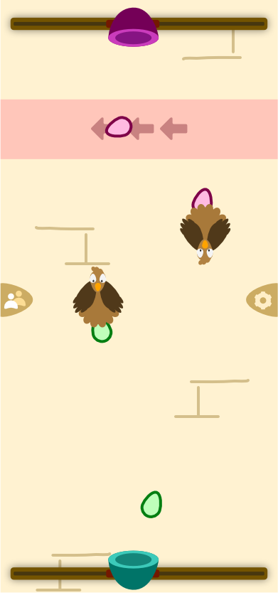

Below is a very rough sketch I did for the idea, then two more detailed sketches I made later.

## Map

Birds appear at the top, drop eggs, then appear some time later

You have a basket at the bottom. Move it around to catch the eggs.

## Basket

Two solid bodies at either side. So eggs can only be caught if they come from above. And if they hit the edge, they bounce back up for a "second chance"

Two sprites: one front and one back. The egg falls between those (in terms of *depth sorting*).

Otherwise, just a basic overlap between egg and square basket shape.

## Input

You can only move your basket horizontally (left/right) along a slider.

-   Touch: swipe
-   Keyboard: left/right arrows

**Multiplayer (2 players max):**

-   Touch: add second player upside-down at the top
-   Keyboard: experiment with adding second player below as well, above the other.
    -   Either reduce range
    -   Or add eggs/systems to let things go for the player below you

## Rules

-   Chickens fly into the screen. (From the side, horizontally, to their end position.)
-   They drop several eggs, before flying away again.
-   For every egg you **don't** catch, they become annoyed.
    -   If very annoyed, they leave a zone.
    -   If somewhat annoyed, they leave a block
    -   Otherwise, they leave nothing

**IDEA:** Might make the first chickens in the game "one-time" chickens. Otherwise, it's really easy at the start: just one chicken, dropping an egg at exactly the same spot, so just keep your basket there!

# Elements

## Chickens / Eggs

This is a one-on-one combination. Each unique *chicken type* lays the same *unique egg type*.

With two exceptions:

-   **Cheeky Chicken**: can lay *any* of the available eggs (clear unique appearance)
-   **Spy Chicken**: has the same appearance as another chicken, but with an icon or overlay added. This is subtle and can be missed. Lays a *different* egg than what it looks like

Every egg activates its effect when **caught.** They are in one of three classes:

-   Good: generally helpful. **Lose a life** if you let them go
-   Neutral: can be good or bad, can also let them go without issue
-   Bad: generally unhelpful. **Lose a life** if you catch them.

Otherwise ...

-   **Regular** (good): +1 point if caught
-   **Penalty** (bad): -1 point if caught
-   **??** (good, multiplayer): when caught, merely returns to the opposite player. Must therefore be caught *twice* to actually get it. (Lots of points)
-   **Heavy:** an egg that just falls faster in general
-   **Balloon:** an egg that just falls slower in general
-   **Extra Points:** an egg that's just worth more points
-   **Heart:** +1 life if caught
-   **Poison:** -1 life if caught.
-   **Freeze** (bad)**:** freezes your basket in place for a tiny bit. (Can you release it faster by frantically tapping keys?)
-   **Magnet:** attracts eggs near it
-   **Repulser**: repulses eggs near it
-   **Speed up/down:** changes movement speed of your basket.
    -   This means there must be some built-in limiter on how far the basket can move every frame. Even when dragging
-   (Height: move your basket line up or down.)

**QUESTION:** make each good egg +1 point and each bad egg -1 point. By default. The regular/penalty eggs simply have 3 points or 5 points.

**IDEAS:**

-   Something about mating chickens, or making them disappear, or making more of them spawn.

## Zones

-   Extra Speed (horizontally): eggs within it are blown more to the left or right
-   Gravity change (vertically): eggs either speed up or are slowed down
-   Size change: eggs slowly become larger or smaller

Lala TO DO => can't really invent many great zones. But that's alright, these few are already fun and simple.

## Blocks

These are things *inside* the level (like a slanted object), that make eggs bounce in weird directions mid-fall.

(Might also be animated. Slowly rotate or scale up/down.)

They also don't need much changing. Prefer keeping them smaller/thinner, to allow more placement options, and don't obscure too much of the level.