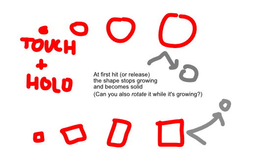

Balls/projectiles will enter the screen. You need to deflect them into the right place/goal. (Or just protect something yourself.)

How? **Press + hold to *slowly grow a circle* at that position.**

* Perhaps best if the circle also collides *while growing*, but becomes solid/fixed *after the first collision*.
* (Otherwise, we might get the problem of "body inside other body, which suddenly became solid and wants the body out of there!")

Once you release, the circle becomes solid and stays for a few seconds. You can only create a new circle once the previous one has disappeared (or started disappearing)

Of course, instead of a circle, this could be any shape (square, triangle, hexagon, ...)

**IDEA:** The thing you've grown *becomes* the new ball. (To discourage people from just growing huge shapes each time, easily defending anything.)

> Would not work if the targets are goals of a specific size. In that case, it should be impossible to grow a shape *bigger* than the goal. But that's hard to calculate for any shape
>
> No, actually easy! Calculate the smallest circle that would fit *around* the shape. (Calculate bounding box. Then calculate distance from each extreme to center point. Smallest circle = biggest distance.)

**IDEA:** Would obviously work well in multiplayer. Though not sure if competitive or cooperative then ...

## Ads

* Cosmetic: different arenas, different shapes, different backgrounds
* Different *modes*?
* "Keep playing" doesn't make much sense in a score-based/team-based sports game. Would only make sense if you play an *endless mode*.
  * So perhaps best to create two modes
  * **Endless** (for 1-4 players, cooperative) => survive as long as possible
  * **Match** (for 1-4 players, competitive) => fixed time limit, most points wins. (If time runs out and it's a draw, the non-drawn players lose their goals (so nobody can score there), and we keep playing until the draw is removed.)