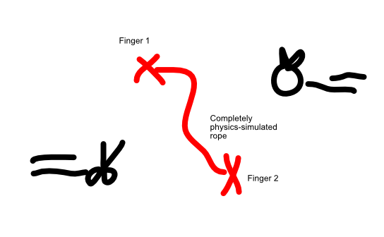

Place two fingers on the screen. From now on, a rope appears between them!

Use the rope to ...

- Deflect stuff (towards where you want).
- Collect stuff (by catching it, by looping the rope around it)
- Avoid stuff (that would cut the rope or give minus points).

Lift a finger and you lose.

## Ads

- End-screen: keep playing
- Permanent Powerup: allow lifting your fingers, stronger rope, longer rope \<= although these could just as easily be powerups within the game itself
