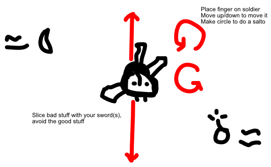

You are a circular soldier in the center of the screen. You have a sword sticking out. (Can upgrade to multiple, or different type.)

Place your finger on the soldier. Move up/down to move the soldier up/down.

Now the important part:

- Make a clockwise circle (with your finger, a small motion) to **rotate one turn clockwise**
- (Counter-clockwise does the same, but in reverse.)

Stuff is thrown at you from the left/right sides of the screen. Anything your sword hits, is sliced.

- This saves you from the many bad things.
- But obviously, there are also *good* things you don't want to hit.

The reason you must do saltos (instead of aiming your soldier where needed), is because it adds a time constraint. You can't just spam the action: you need to time them well. Slice some things, avoid others.

> This can be a powerup, though, where you *temporarily* get the ability to aim precisely.

## Questions

**Is it possible ...** to add a two-player mode? Players are side by side, each uses their own finger. This means you get a mini-game for yourself, but you also have to deal with whatever the other player decides to let through.

**Is it a good idea ...** to add this rule: **lift your finger? You've lost!**

**Keyboard/Controller?** Would just be two buttons (clockwise/counter clockwise). Controller should just dispatch fake touch event based on joystick position (so you can rotate that to create saltos).

## Ads

End-screen: continue playing

Permanent powerups: multiple swords, special swords, longer swords, lifting a finger doesn't lose you the game, other items that can appear, new moves? (Such as a dash forward/backward?)

Cosmetic: different soldiers, different backgrounds, different look for the swords

Investigate if the **jump-start/head-start** idea is viable? (You can buy or get these. Press them at the start to immediately jump to the later sections, skipping the grind at the start with which you won't have any trouble at this point.)