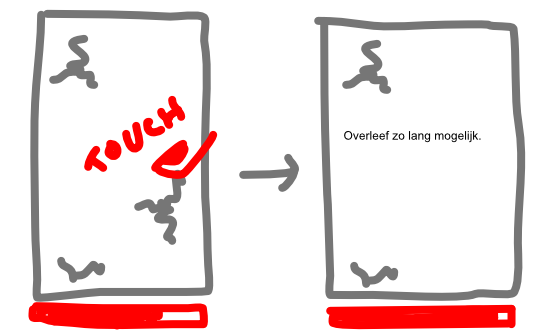

You're in a submarine (or some other glass container) under water. See some fish in the background.

**Random leaks/breaks appear in the glass!** Survive as long as possible.

The glass has **integrity.** Starts at 100%, you lose when at 0%.

Each leak damages integrity. Repairing gets it back.

## Different Leaks?

This increases in difficulty. Each different type of leak requires a different gesture/movement/action to repair it.

* Touch to repair
* Touch + hold
* Scribble/shuffle over it
* Make circles over it
* (Draw a specific shape around it?)
* Tap repeatedly (X times) => but tapping too many times destroys it, so we need a second or two delay before it actually "repairs" it
* A leak that (somehow) *moves* over the glass.
* A leak that grows bigger over time.
* (One that grows smaller would be a bit useless, as it would then repair itself? Or is that an interesting strategy as well: leave it be and hope it goes away soon? Would work if it shrinks *really slowly*.)

## Modify for Desktop?

Add multiple pointers that can be moved/clicked.

*Needs something extra ...*

* Maybe pointers can only move *in one direction*
* And there's a button that, when pressed, changes this *direction*
* And maybe another button that makes you *ignore* those general commands, or everything moves faster, or something like that

## Ad Support?

Permanent powerups:
* Many different fish types => these make the game *harder*, but are also more *rewarding* when you beat them.
    -   If you come very far, and it has no new fish type to include, it unlocks it by itself.
* Increase glass integrity
* Increase speed of leak removal
* Increase points for removing something. (Or decrease penalty when new leak is added.)
* Score multiplier in general
* Multiple lives => when you're supposed to die, it takes a life instead, and removes whatever was killing you.

End-screen tricks:

* Keep playing! (Resets integrity to 30% or something.)

Cosmetic:

* Different backgrounds
* Different leak designs? Different shield designs?

## Research

URL (easy 3D silhouettes through stuff): <https://www.reddit.com/r/godot/comments/u2yssh/today_i_learned_how_to_do_character_silhouette/>

URL (using TouchScreenButtons): <https://docs.godotengine.org/en/stable/classes/class_touchscreenbutton.html#class-touchscreenbutton-property-passby-press>
