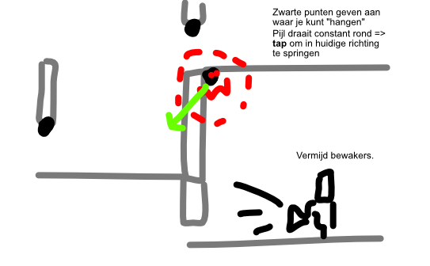

You're a ninja. Your task is to infiltrate somewhere / steal something.

You can only stay / hang / stay stuck on specific parts. (Clearly highlighted and indicated.)

An arrow around you **constantly rotates*.*** (Just clockwise, moderate speed.)

**Tap the screen to jump in the direction the arrow currently indicates**.

This is a "free jump" => you can be bounced to a different direction along the way, things might change. Only once you're close enough to another sticky point, it snaps you to it and you stop. Then you can jump again.

(For example, you ignore most walls. But there might be special "strong walls" or "safety walls" that will bounce you back on impact.)

**Is it possible ...** to make levels randomly generated? (Maybe do both. Design some levels by hand as a story/tutorial mode *and* to get a feel for it. Then make an endless mode, which is the real challenge.)

## Ads

Cosmetic: different look for ninja, different look for levels

End-screen (in endless mode): continue playing

Story mode: approach it in the "puzzle" way. You can ...
* Reset to last "stuck point" (the equivalent of an undo)
* Unlock new worlds or bonus levels with ads
