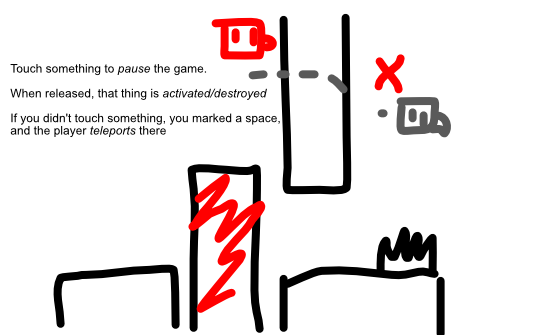

A basic platformer, but

* You are automatically running/jumping
* Touch/Hold the screen to **pause** the game. (Freezing everything. When released, it continues normally.)
* It only registers one finger => **what** you touch upon pausing is important
  * There's a cooldown on pausing. (So can't use it indefinitely, immediately after each other.)
  * The thing you touched is *activated* or *destroyed*, which can be really bad or really good based on the thing (and the circumstances)

Perhaps a better idea**: your player will try to move to the thing you touched.** (Or it just *teleports* there? But then we'd need some real limits on this teleporting. Like => there are cells/areas that **block** teleporting, so you need to remove those first if you want to use it.)

Ideas:

* You can simply remove walls/blocks blocking you with this touch.

## Ads

* End-screen: continue playing
* Permanent powerups
* Cosmetic