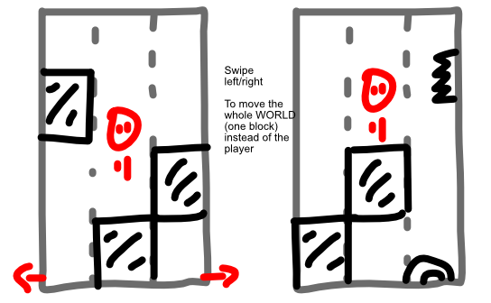

A platformer game where you try to get as high as you can.

However, you can only **swipe the whole world one block left/right.** 

Your character is just in the middle, constantly jumping, and you must literally *change the floor beneath its feet.*

**IDEA: A similar but cool idea**, is that "jump is always up". (Maybe that should be the *name* of the game.) All you can do is rotate the *world*. But when you jump, it's always *up* (straight vertical).

## Progression

To prevent just staying still indefinitely, make some *lava* (or something) come up from the bottom slowly? (When it reaches you, you die.)

Add a shop/way to get special items. Why? Because the terrain gets harder and harder as you go. (Bigger gaps, tougher enemies, more chance of bad luck with the generation.) With the right items, you could overcome then. Making players feel like they should've "played better", instead of the generation being unfair.

## Map

Support both portrait and landscape?

Multiplayer?

* Certain blocks only block/use/activate *one player*?
* (On wide screens, you could have two instances of this game next to each other. But on mobile portrait? You'd almost need to put those screens *opposite* each other, like I did with *Monsters under the Bed*.)

## Ads

* End-screen: "continue playing"
* End-screen: "buy items for your next run" (?)
* Cosmetic: different biomes/backgrounds, different player character \<= though, again, these might also just have different functionality
