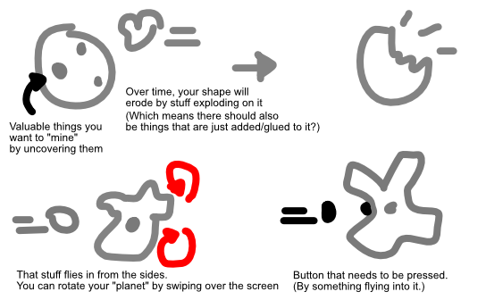

A (relatively big) shape appears in the center. Easiest to start with a circle (and resemble a planet), but could be anything.

**Rotate** it by swiping your finger across the screen.

Stuff flies in from the edges. (Not necessarily left/right, not necessarily in a straight line.)

React to it!

* Some things are allowed to hit the edge.
* Other things should be deflected. (You get a force field, or cannons, or something at some point on the surface.)
* But many things have to travel *into* the shape => **inside of it are certain locations, you need to uncover those and then allow stuff to come at it**

**Is it possible/better ...** to start with a pre-holed shape? :p (Which would be done by just "simulating" some hits in advance. During the game, this cannot change anymore, and it's all about guiding stuff towards the right spot.) => this could be a whole different **mode**.

**How do you win/lose?** There are many ways to score points. Or you just need to "stay alive" for a certain amount of time. When you win, you move to a *bigger* planet, with *more dangers,* and the game becomes *faster*.

You lose if the core of the planet is blown up / the planet becomes too small.

**IDEA:** Once you've unlocked the next level (either by playing well, or by buying it with an ad), you can start from *there*. This has the same function as a "head-start", while also working as different biomes and clear targets to aim for.

## A One Button Game?

If alone, your planet will rotate clockwise automatically, but pressing/holding your button makes it rotate the other way.

If with more players, then each planet gets _two players_: 

* Player A's button rotates the planet clockwise
* Player B's button rotates the planet counter clockwise

When more people log in, we can just _place new planets_, and the camera zooms out to fit.

## Implementation

Use Godot's `Geometry2D` functionality for all this => when something hits the edge, it explodes (like in Worms) and changes your shape.

Make the gapland a *static body*. When turning it, instead rotate *the whole world*. 

The other bullets are kinematic/rigid bodies. *They* should register collisions and do all that stuff. (This easily allows the gapland to be a concave physics shape of any kind.)

<!---
### Ads
* End-screen: keep playing
* Cosmetics: different backgrounds, different planets
* ?
---->