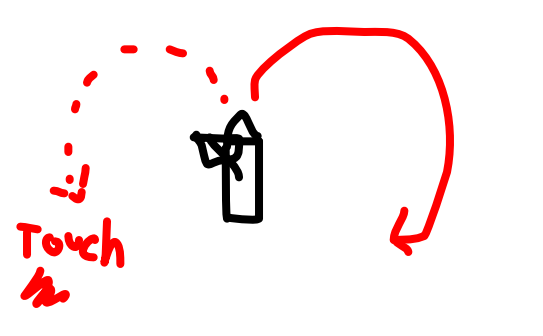

A very simple game about sailing around as a pirate who can only rotate one way.

## Objective

Get the highest possible score, before your ship is absolutely destroyed.

## Input/Action

**You always move in clockwise circles by default** (So you sail forward, but turn to the right.)

**Hold** your button/touch the screen to move in counter-clockwise circles instead.

## Map

Top-down view of ocean. You're a small ship in a small area.

Hexagons seem nice for this? (Would need custom collision detection. Do you simply die if you run aground, or are you slowed down and bounced back?)

That's it. Dangers will appear. Things to attack, or things that attack you. Area grows larger and larger over time (in circles). You can upgrade your ship over time.

## Implementation

* Use noise maps in the background
* Only draw the hexagons within view, the rest doesn't exist => but because of noise sampling, the world stays consistent
* Enemy ships and powerups are also simply repositioned/removed when too far away. (But not too quickly, so you can still go back to them if you remember.)

## Ads (if a mobile game)

Cosmetic: different ships, different biomes/worlds . (Might not be just *cosmetic*, but actually have different functionality!)

End-screen: keep playing

Maybe there are different "islands" (or "island groups") to play. You can unlock the next one with a number of coins => which you get by playing, or by watching an ad.
