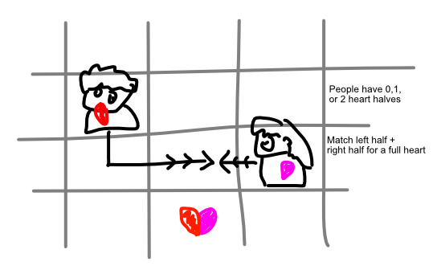

## Objective

Give all people a full heart

## Map

People in some environment. Start with 0, 1, or 2 half hearts. (Where 2 halves = one whole of course.)

## Input

Move people.

-   0 half hearts? Can't move.
-   1 half heart? Move 1 space.
-   2 half hearts? Move 2 spaces. (Or as far as possible.)

## Rules

When you enter a square with someone else, your heart pieces are combined and given to both. (So need two matching halves, or someone with a full heart enters someone with no heart.)

-   Once combined, those people leave.
-   Cannot enter a square if your hearts don't match it.
-   Stand next to someone receiving their full heart to *switch* yours from leftright. (A "change of heart".)

## Ideas & Variety

How to keep this interesting for longer? Or is this just a small game with this simple mechanic

Maybe we can have different kinds of people (with different abilities)? Would be really hard to find something that works well with the theme and isn't just generic.

Some ideas:

-   Someone that *drops* half hearts when walking (which others can pick up).
-   Someone with a *time limit*. (Each X turns, they lose one half heart?)
-   Someone that doesn't leave when receiving a full heart. (They turn into stone blocking you?)
-   Someone that throws its heart(s) to the next square, instead of moving into it.
-   A separate class (animals?) => class A only shares hearts with class A, B only with B
    -   Although, people can obviously love their pets, so how does that work?
    -   Maybe this is just *one type* => one animal that only wants another animal (No Pet), one human that only wants another human (Pet Disliker)
-   Someone that needs *three halves* or only *one half*

Perhaps this is better: **once two people have their full heart, they get a special power.**