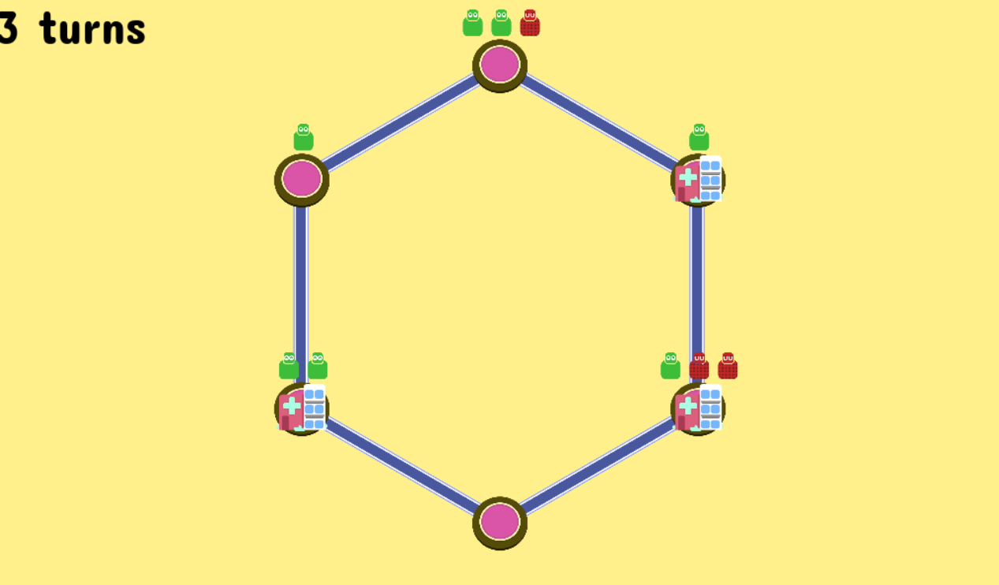
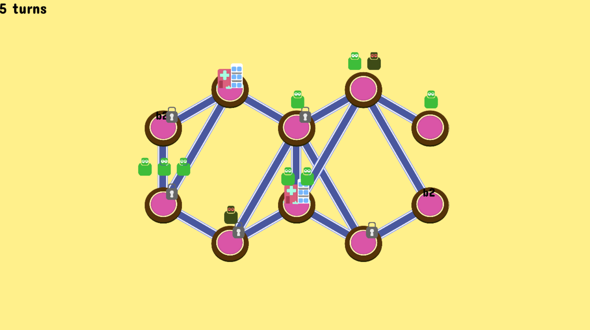
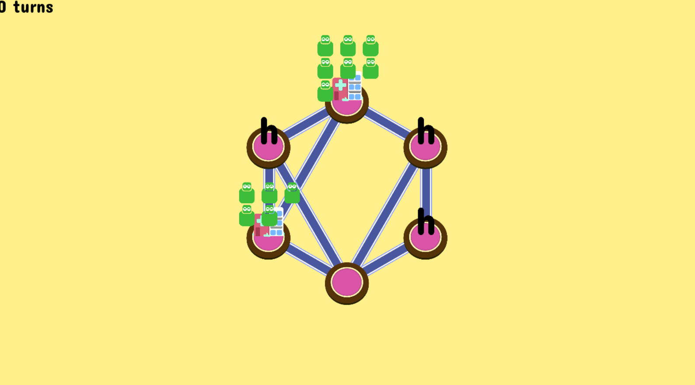
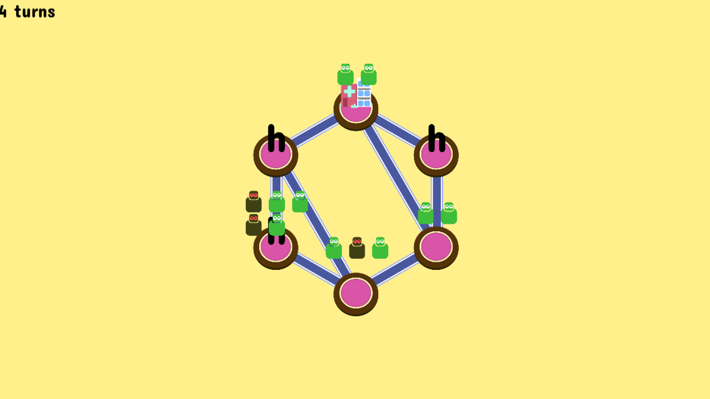

A puzzle game about healing one town after another. Every turn, you click two locations, and it sends all people from location A to location B. Sick people will infect even more; healers will heal people at the new location.

The puzzles are randomly generated by a simulation. But that's not a requirement; they can easily be hand-crafted.

I created a working prototype when the Corona virus was running rampant (guess where the idea came from). See the screenshots below. 

_As I explained at other puzzle game ideas of mine, the idea worked well, but I stopped developing mobile games (and that's where such a puzzle game usually belongs/makes money) and as such abandoned the idea._

## Objective

You **win when nobody is infected** (after the last turn).

Later, secondary objectives will appear. Although it's *better* if these goals automatically emerge through gameplay.

Examples:

-   You must have enough money
-   Not too many people must be unhappy.
-   Not too many people must have died.

## Input Method

Send *people* from location A to location B. (Click on A, click on B.)

By default, you'll send *all people*. Many locations, however, forbid certain people from entering or will split the party.

## Levels

A randomly generated city/town/terrain. This is a (fake) hexagonal map.

Dots on the map represent **locations**.

-   Locations can have a special building type, a general property (such as a number that can be used by the building), and any number of people.

Between locations are lines that represent **connections**.

-   Most connections follow the hexagonal grid, but sometimes they do a special connection (and can overlap).
-   You can only send people from location A to B, if they have a connection and there are people to send.
-   Some connections are special. (They can be railroads, or one-way connections, etc.)

**People** have the following properties:

-   Base type (normal, tourist, etc.)
-   Infected (yes/no)
-   Infection time (the exact turn when your infection started, so you can auto-heal or auto-die)
-   General property (depends on the base type, if used at all)

## Connection

This is an overview of all connection types. These are saved by *number*. (0 = regular.)

1.  Railroad => a traveler will use the first (available) railroad at the end of each turn
2.  Highway => a bus driver needs to be present for a group to cross the highway

## Buildings

This is an overview of all the special buildings, ordered by String id. Some notes:

-   The first few buildings are mostly meant to *reduce* possibilities.
-   By default, buildings have a max capacity of 4 people
-   By default, you move *everyone* from a field

An alphabetical list:

a. Nothing.
b. Hospital = only sick can enter, cures them instantly
    -   ?? (reverse hospital) = only healthy can enter, infects them instantly
c. ?? (unlocker) = removes lock when someone enters from empty state (following quarantine rules), becomes locked if left empty
    -   ?? (locker) = removes lock when left empty, becomes locked if entered from empty state
    -   "from empty state" = necessary? Or not? Even properly implemented???
d. ?? (bubble) = don't enter if there are *other people*
    -   ?? (crowdy) = don't enter if there are *no other people*
e. ?? = *splits* the group; healthy people go, infected people stay
    -   ?? = *splits* reverse; infected people go, healthy people stay
f. Supermarket = hungry people must visit to become "normal"
    -   ?? = when normal people visit, they become "hungry"
g. Test location = tests people, already tested people can *not* visit
    -   Airport/Immigration = Untests people, untested people can *not* visit
h. Airport = only tested and healthy people enter (splitter)
    -   Only untested and unhealthy people enter???
i. (New) Hospital = when vulnerable people are on it, their infection countdown "stops"
    -   ??
j. Percentage Splitter = only the first A% ( A = param) of people will move to it
    -   It just reverses the percentage on the building

**Problem 1 =** there's only *one way* to cure infected people. In all other cases, they just spread and spread. That's why something like a *timer* or *immunization* (after a while) would be super useful early on.

**Problem 2 =** after using a hospital, people are just ... sitting there doing nothing.

> Solution = locations can, by default, only hold X people maximum
>
> Solution 2 = people are automatically ejected from the hospital. (But how to do that in a systematic way?)

**Quarantine** = whenever there are at least X infected people in a location, it goes into quarantine.

> Alternatively, if more than half of the board is infected, *everything* goes into quarantine? (Or you just lose instantly?)
>
> Alternatively, there are "government people", which will start quarantine when they visit a spot.

**Supermarket =** all hungry people must visit the supermarket

> Or simply ... "all" people must visit the supermarket? Is that too hard to keep track of and solve??

**Tourist** = wants to end the game on a tourist destination

> Alternatively, it automatically disappears when it visits. And then you can't win if any tourist is still on the board. (This is way *cheaper* to calculate and check!)

**Special location ideas:**

-   Bank/Open Stores: this is where money comes from?
-   School: young children must be sent there, otherwise they become unhappy or something
-   Research Center: send *infected* people here to find a vaccine
-   Hospital: send people here to cure them or just help them. (Later on, you might need to discover a vaccine first?)
-   Dock: at the end of every turn, a new person arrives there (immigration/emigration)
-   Airport: people can travel from there to any other airport on the map (but ... ?)
-   Train Station:

## People

This is an overview of all the people in the game. Some notes:

-   Being infected, or not, is a *separate* property (that anyone can have)
-   Some people have a specific *function* and look distinct, such as *money*.

An alphabetical list:

a. Regular
b. Hungry
c. Doctor = heals one person (at the end of each turn) on its location
d. Elderly = immediately dies when infected
e. Vulnerable = dies after X turns, unless saved by a hospital
f. Traveler = if they can, they take the first available railroad at their location at the *end* of each turn
g. Bus Driver = needed to cross highways, can *not* drive if sick
h. Someone that takes up *no space*, or someone that increases the *max space* of a place, or someone that decreases the *max space* of a space
i. Someone that can "flip" locations to their twin!
j. Tourist
k. Young
l. Elderly
m. Unfit
n. Unhappy
o. "The Toucher" = whenever they move across a connection, they actually *infect* the connection, causing *everyone* who moves across it to become sick
p. "The Distancer" = whenever infected, they get a *timer* and will automatically heal when it's up. (NOTE: In simulation, I should just save *when* the timer started, and then check if it's up yet. Much more efficient than updating all counters, every move.)
q. *Money*
r *Builder*
s. *Government*
t. *Researcher*

## Miscellaneous Ideas

### Core Game Loop

-   Keep people moving (and not dying)
-   ... but keep infected people away from the rest
-   ... and cure them quickly if necessary
-   ... to keep spread of the virus contained

### Main Mechanics

**Idea #1:** Literally everything is represented by people.

-   Regular people: normal, sick ( = red?), cured/immune, unhappy, unfit, elderly, child
-   Sending money = a yellow shiny person travels with you
-   Building new locations = a builder person travels with you
-   Initiating quarantine = send a government person to a cell

**Idea #2:** many locations determine *how* people are moved.

-   XX: send 1 person to each connection, clockwise, until exhausted. (In that case, people should be *ordered* on their destination, so you know what will happen.)
-   XX: whenever a person is at this location, or a person is *young*, they *will* move at the end of their turn. (Whether you like it or not. Perhaps there's a special cell to contain *those* people.)

**Idea #3:** Different virus properties! At the top of the screen, you can see different properties and special abilities of the virus. (Only introduced much later in the game, of course.)

> Also, virus mutations, though that might be hard to implement well.

**What's important?** For the *simulation* to work effectively, many options should be shut down from the start. Ideas for that:

-   Quarantine mode: nobody can go in or out that place
-   Locked fields: these are inaccessible (and start empty, maybe not?) until you *unlock* them
-   Empty fields: these do nothing special, until you send people or build something here

**Simulation?** It mostly works the same as "Square Ogre".

-   I create a random set of points, with random connections, and random starting people.
-   Then it tries all moves, time after time, until it hits all the objectives. (Set a minimum and maximum number of moves.)
-   Whenever we do a new move, we copy the board and clone any cells/connections/people that were modified. (Otherwise, we keep reference to original, to save a *lot* of memory space.)
-   For the *vaccine*, however, it just decides on a random moment to use it? (It counts how many "research" points you have and sets that as the apparent "threshold" for a vaccine.)

## Notes & Naming

Land of Lockdown? The Quarantine Quest? (Or something else with the word "quarantine")

A scaled-down, simpler, cartoony, mobile game version of Epic Medics.

(Should find a better name. *Virus* will only return antivirus apps. *Pandemic* is overused. *Plague* is a well-known established game. And *LockTown* is already an escape room ...)