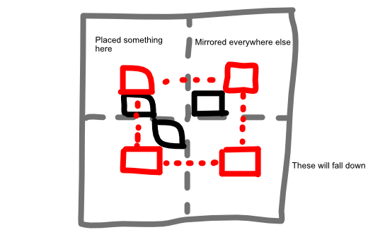

The field is split into several parts. The line dividing the parts is a **mirror** => so placing something to the left of it, will *also* place that thing that number of spaces to the right.

The objective is just a "Match-3" variation. You're placing monsters and trying to get combos.

This means

* The field starts (almost) empty
* You can't place stuff in filled locations => use empty locations in mirror worlds to place something where you want
* There should be many monsters modifying what happens (remove stuff, jokers to match anything, monsters that move around) => otherwise the two worlds just become identical

Visuals? Thinking about just rounded-cube-like-monsters with faces like *Snakebird*.

## Ads

Use the "Candy Crush" model.

- A list of levels; but they are random. (They just have a fixed shape, or what types they do/don't include.)
- On the end-screen, you can watch ad to "continue playing"
- Also watch ad to unlock new worlds?
- Use a "lives" or "energy" system?
- Cosmetic: new backgrounds / environments, new monster looks?
