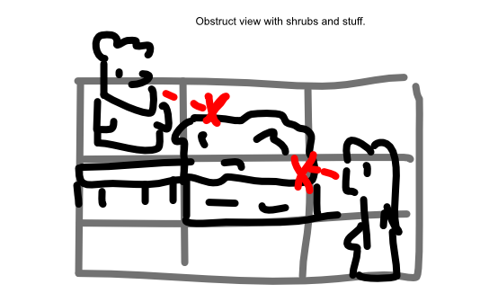

Puzzle game where **neighbors don't want to see each other**.

Place hedges between them, rotate them, move them, all so they *don't* see anyone else.

> Haha. Maybe there is some way to *adopt* others, so they're now part of your household, so you _can_ look at them without issue :p

Why am I not that enthusiastic about it?

* The theme might be a bit negative/off-putting.
* Feels like there isn't much flexibility => it's not like you can move whole *gardens* and *houses* and *groups of people* on a whim.

At the same time, it *is* an interesting concept (cut off sight lines), and the puzzles should be able to *look good* (as you get a certain garden lay-out).

## Ads

The default puzzle stuff.
* Getting a hint
* Getting an undo
* Unlocking a new world