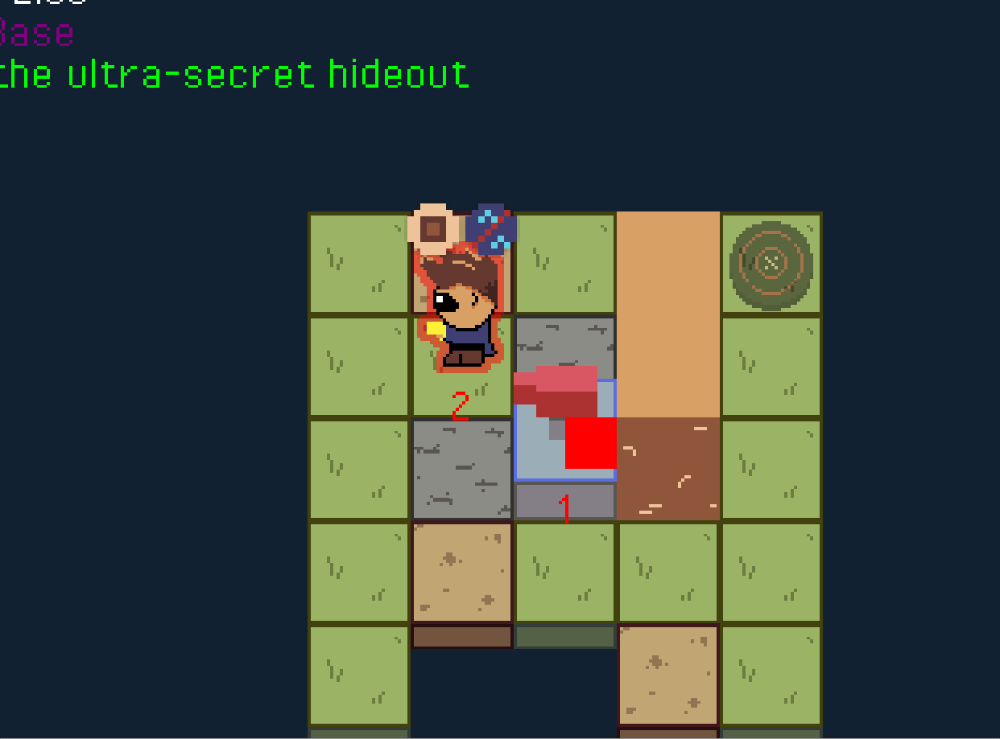

You are a legendary spy known as "The Extractor". You cannot use a weapon. You cannot punch guards in the face. You cannot even type your own password correctly.

> **But you can *extract*.**

All objects in the world are build from basic building blocks. A secure door, for example, might have the properties "locker" and "heavy". You can *extract* these building blocks (taking them away from something) and if needed *insert* them somewhere else.

That's how you will solve the puzzles. And save the world, protect us from the aliens, save your marriage, you know, whatever your motives are.

_As usual with my younger self, I made the difficult core of the idea work. I built the framework that allowed everything in the world to be made from small "modules" that you---the extractor---could take out or put back in. But usually when the hard part is over, my brain is bored and moves on, so I never made anything else. I still think it's a GREAT idea that naturally leads to very creative puzzles._

Below is the only visual proof I have left of making this prototype :p Maybe I can share the source code and `.exe` somewhere too ...

Below is just a long list of details on how the rules work, how to implement it, how I'd structure a campaign/first ~10 levels, etcetera.

## Guidelines

How to overall systems/singletons work and guidelines for programming/game design.

Make sure all *relevant* configurations (things that must be memorized and aren't reconstructed when creating a module) are saved in the *params* variable.

Before each *Player* turn begins, the undo system saves the whole world state. (The basic properties (x,y,rotation) and a copy of their parameters.)

When rewinding, we simply take the last recorded state, delete all entities, and recreate them from the given settings.

> Players are *not* recreated and deleted? Or I must rewrite some code that handles default settings and waiting for (gamepad) input, as that's only executed once.
>
> I could move that code to the entity itself, including the "waiting for gamepad". (Or could that even be put into individual modules?)

### Resource loading

Each module is responsible for their **own** resource loading.

All sprite sheets are power of 2. Frames are given as integers, converted to (x,y) coordinates at runtime.

-   **ModuleViewer:** uses ModuleIcons sprite sheet. The indices are specified in the class.
    -   **Size**: 16x16 per icon => 16x16 sprites in total? Do I need 256 icons?
-   **Sprite:** uses Sprites sprite sheet.
    -   **Size**: 32x64 per sprite => 16x16 sprites in total for 256 frames.
    -   Has dictionary with "spritename" => "object"
    -   The object contains animations, all optional.
        -   Static = one frame (all rotations)
        -   4Frame = \[a,b,c,d\];
        -   Unlock = \[a,b,c,d\];
        -   Idle = \[...\];
        -   Move = \[...\];
-   **Grid:** uses the TerrainTiles sprite sheet for static loading from JSON.
    -   **Size:** 32x40 per sprite (change this?) => 8x8 sprites in total, 64 terrain frames.

### Configs/Params

All modules have a **params** variable, which is a Config() object.

Any properties, configurations, settings, etc. are stored in here and checked via the function **module.is("key", value)**. There is *nothing* hardcoded (except for stuff that is irrelevant during runtime, as it's reset or created in the constructer.)

Why?

-   More consistent code.
-   Much more flexible---can accept, update, and read anything.
-   Easy to save and reload (for undo-system and stuff)

Whenever a function reads/changes these things, use the variable **inConfig** for what's coming in, and **outConfig** for whatever is going out.

All module-bound functions need a parameter **(?config:Config)**. However, any other functions (such as **bind()**) can leave it out. Do so, for conciseness and clarity.

### Entity Params

Entities also have a set of global/overall parameters, such as "SOLID" or "WEIGHT".

-   All of these are integers. If they are zero, they do not exist/are at their lowest point.
-   Any module can add or subtract a value from this, changing the total. To keep this consistent, this is done during init(), and then neatly removed during shutdown().

It's important to remember that **modules are nothing by default**.

They are not solid, they don't have weight, or a representation, or whatever. This allows me to keep things simple and consistent, and to keep all parameters (of entities) integers.

(So, an entity without any modules, simply is invisible, walk-through, weightless, etc.)

## Levels

*Structure?* The game consists of separate **missions**. Each missions has several unique **levels**.

> They start *really* small. Near the end, they can be quite large, if they consist of multiple rooms or multiple locations, or even multiple height levels.

*Visuals?* It's **2D** but with a ¾ top-down view, allowing some sense of **3D** and moving around in space. It's forced to a **grid**.

*Objective?* The **objective** ( = how you win a level) is wildly **different** each time!

> It might be "collect these things" (even though some of them aren't collectible by default). It might be "set the teddybear on fire" or "reach the platform".
>
> The most common one, though, is "steal this stuff" or "unlock this locked door".

*Gameplay?* The game is **turn-based**.

-   Moving and rotating cost an action ( = your turn ends after using it).
-   Your extractor is automatically pointed at whatever is *in front of you*.
    -   When you can influence something, symbols pop up that show all the modules within this entity.
    -   Player modules are always visible above their head.

-   Each entity that can *do* something subscribes to the TurnClock. When your turn is done, the clock calls the next entity in line, and that's how you go through turns *in order*.

### Singleton: TurnClock

This is the main "game clock":

-   Knows the current turn and round.
-   Entities can "subscribe" to it => the clock then tells them when their turn starts and ends.
-   After each turn, the clock advances, calling the next entity in line.

### Related: Clock Module

-   Only the "Clock Module" listens to TURN_START events.
-   When it happens, they gather a list of all the modules on the entity, who want a turn.
    -   Module parameter *turnModule* = true/false.
    -   Call function on entity listModulesWantingTurn()
-   The entity lists all objects wanting a turn and gives it to the Clock
-   Then they simply call the first one. Whenever they receive a MODULE_TURN_END event, they call the next one. Once all have been called, the module invokes the TURN_END event.
    -   Some modules have a forced "endsTurn" parameter.

## Input

Input is a different beast, as it is async ( = not reliant on) the clock and turn system.

-   Input modules are LOCKED until their turn.
-   They are NOT counted towards "modulesWantingTurn"
-   Instead, when all modules have done their thing, it checks if any modules want input.
-   If so, it starts their turn *all at once*. This unlocks them.
-   When the full Entity turn ends, *they are all ended and locked again*.

## Singleton: Grid

This holds the (underlying structure) of the game world:

-   A 2D array with terrain => this is fixed, loaded once, never moves.
-   A 2D array with entities => this must be populated and updated during the game.
-   Any *module* can subscribe to the grid, receiving updates when it is updated.
    -   (Why? For example, if someone moved in front of us, we want the extractor to immediately recheck their active object. Not only when we rotate in our turn.)
-   Besides that, it provides many helper functions for calculating coordinates, getting and setting cells, and "magic constants" for grid size and such.

## Menus/Campaign Screen

The whole game is a level! Even the menus, the campaign screen/world, are all just using the exact same level code.

-   Campaign = big level where the player has a different set of modules. (One that allows you to quickly travel from mission to mission.)
-   Menus/Buttons = use DomKit as an overlay. Should not be heavy on performance to just keep it on always and redraw (set visible = false/true) when necessary.
-   When switching levels, make sure to delete/destroy/clear everything.

### Alternative methods considered:

-   The whole game is a single state, we just reset/recalculate/restart the right things upon loading.

-   Create different classes, which inherit from State, which hold unique game states. Each class has its own Object onto which everything is attached. When switching scenes, this object is simply removed. (Check whether this removal/garbage collection actually works.)

## Tools: Tween & Camera

**Tween:** regulates tweening animations. Any object can start a tween using parameters.

**Camera:** all objects (that are not part of the UI) are part of the *layers* on the camera.

-   Layer 0 is the terrain + entities, and tries to stay Y-sorted.
-   Layer 1 is for special cases
-   Layer 2 is for icons and effects, like the module icons.

The camera automatically centers on the current active entity.

## Extractor (Rules)

The extractor points at whatever is in front of you. When pointed at, an entity (if it has a ModuleViewer) will show its modules.

-   Modules that have **hidden = true** will not be shown
-   Modules that are **duplicate** cannot be extracted/inserted. (Modules must be unique per entity.)
-   When counting modules, therefore, hidden and duplicates are ignored.

There's one button for extracting, and *another* for inserting. (They are very different actions; it's important to know the difference every step of the way.)

When held down/pressed, you can scroll through modules with the keys you'd normally use for movement. When released, the module you're currently holding is transferred.

## Campaign

**GENERAL IDEA:** Someone stole something (valuable) from the Extractor. You're trying to get it back.

**SECOND IDEA/THEME**: During the game, the player "discovers more about himself". Over time, you see more and more modules, and are able to give/take more. (This could be somewhat philosophical, with the player discovering what made them who they are, and what determines their actions/course in life, etc.)

**RULE #1:** Everything is unique! Every object in the world is made up of modules, and can be/hold anything. Try to "instantiate" default objects as little as possible.

-   Consequence 1: If something is in the level, it should have a clear purpose. (Provide a module, block a path, prevent an easy solution, etc.)
-   Consequence 2: Add one (or multiple) ways to discover modules.
    -   For example, the **ModuleScanner**: scans a nearby area and reveals all modules on objects within the area.
    -   There could be several variations on these. Maybe **NightVision** or **GemGrabber** (which shows you where a gem is, useful for levels where I hid gems in unfindable places on purpose).

**IDEA:** Modules are persistent across levels *within the same mission*? (The JSON file provides several required modules, but anything else you transfer from a previous level stays in your inventory?)

### Mission 1: "Locks & Lies"

**Story Start:**

-   "For all my life, I thought I was the only extractor."
-   "The rule was clear: this power may never fall into the wrong hands. There may never be more than two extractors."
-   "And so I became The Extractor. I wielded the power with great care, precision and responsibility for years."
-   "And that's when I met him. Or her. Or it, I do not know."
-   "What *do* I know? They also had the power of extraction. And boy, they did *not* handle it with care."
-   "They stole something from me -- I'm going to get it back, whatever it takes."

**Goals:**

-   Try to do a textless tutorial
-   Teach all basic controls and ideas in the game. (With clear info, but also allow experimenting.)
-   Make people excited! Show some cool stuff you can do.
    -   For example, you can also use the code to unlock *another* door (in level 4). Behind this door is a hidden gem, which you can collect during the game.

**Level 1**: Show keys for moving around.

-   Objective: reach the secret entrance
-   Learning point: can't go off the map/walk over water
-   Learning point (perhaps): can't move into lasers/cameras/someone's view?

**Level 2**: Show key for rotating. When you look at something, it shows the modules it has.

-   Objective: find the object holding the key.
-   Learning point: your own modules are always visible above your head.
-   Learning point: different objects can have different modules (even if they look the same).

**Level 3**: Button for extracting. When looking at something, use it to extract a module (and give it to yourself).

-   Objective: extract the key and go to the next room.
-   Learning point: extracted modules go to yourself
-   Learning point: no duplicate modules??

**Level 4**: Button for inserting. Same idea, but you extract from yourself and insert it into the active object.

-   Objective: insert the key into the locked door (and go to the next room?)
-   Learning point: inserting removes it from yourself.
-   Learning point: ??

**Level 5**: The fun begins => everything you've learned, but now without hints.

### Mission 2

This properly introduces turns and move counter:

-   Every entity that has a (hidden) Clock module, gets a turn
-   You can move multiple blocks per turn.
-   However, the more modules you have, the *slower* you move ( = less spaces you can move)

Implementing move counter:

-   There must be a counter that shows how many steps you've already taken this turn. (And how many steps you can take in total?)
-   And your turn must only end once the counter reaches 0.

**IDEA:** Mission where you give away your rotation module (to something else that has a Clock). Will allow you to rotate that thing to where you want.

**IDEA:** Similarly, give away your movement control, and you can move something else to where you want.

### Mission 3

Introduces **weight**:

-   If I add multiple height layers, then weight/gravity becomes a thing. You only fall down if you have weight, weight = 0 means floating, weight \< 0 means you fly upwards.
-   Every (visible) module adds to your weight.

Additionally, something that is **light** can be pushed by something that is **strong**. (So, to be able to push something, your character must be strong, and the other thing must have few modules/no modules changing its weight.)

**QUESTION:** But, objects can also be attached to things, right? Like a fence that's pound into the ground. Does that just require more strength? Or some other action to "cut loose" objects? => Maybe a module "Connection" or "Tether". You can either remove it or cut it loose some other way.

### Mission 4

Introduces **lives** and other **living entities** (or should they come earlier?)

-   **QUESTION:** How do "lives" work? Is "Life" a separate module? If something with that module is hit, it dies and destroys itself? Or is this applicable to all modules, which can be damaged, and finally break?
-   Or, when something breakable/alive is hit, a random module is destroyed?

**Module "FixedPath".** This is given to guards/other living entities in the world.

-   Array of 2D vectors + a counter.
-   After every turn, it just increases the counter, then next turn it takes the next step.
-   (If you get this module from someone else, you just copy all of this and continue from your own position.)

### Mission 5+

Look at my list of modules to see what could be introduced.

I think characteristics (and their combinations) can be interesting. Making someone "in love" or "hungry" is more interesting, than "extracting stone from a wall".

**IDEA (Hard Level):** A level where you must give AWAY your Clock module, and then just wait a few turns until all other entities solve the puzzle for you!

**IDEA (Hard Level):** You can switch/flip the actual SPRITE, introducing some difficulty: you now need to realize that your player looks differently. (Maybe you can use this to bypass cameras made to recognize you specifically?)

## Modules

The core theme of the game/levels: **you are a spy, but you cannot fight/hack/whatever (by default).** Instead, you have an extractor, allowing you to retrieve and lose any ability you might need from the environment.

The general idea: **modules should do a single, clear, specific thing**.

I separate five different kinds of modules:

-   **Key Modules:** Required for making the game/players function, mostly invisible and used by the backend.
-   **Entity State:** change state (make an entity solid, or heavy, or big, ...)
-   **Power:** grants a (huge) power or skill (such as rewind, mind-reading of guards, etc.)
-   **Characteristic:** personality trait (such as "being in love", or "being cautious", ...)
-   **Objects:** don't do something by themselves but can be added to other things to make stuff happen (such as adding a *key* to a *locked door*).

A common occurrence across these modules are **malfunctions:** blocks something (you can't use an ability, something is disabled/locked, you skip turns, etc.)

**QUESTION:** Where do modules like "on fire" or "wet" or "damaged" go?

### Key Modules

-   **GridMovement:** on press of a button, you move forward in a level.
-   **CampaignMovement:** uses arrow keys/analog stick (flicks) to move between campaign levels.
-   **GridRotate:** uses arrow keys/analog stick to rotate freely
-   **ModuleViewer:** shows all (non-hidden) modules on this player and allows interaction by extractor
-   **Extractor:** points at whatever is in front. Press one button to extract, another to insert.
-   **Clock:** starts the turn of an entity (when instructed by the global TurnClock), makes sure modules follow order, and then ends the turn properly.
-   **Sprite:** displays a visual sprite of a certain type. Can take 4 angles (listens to rotation) and have effects based on conditions (for example, transparent when object isn't solid)
-   **Objective:** gets the level objective, checks after each turn if you've reached it
-   **FeedbackMessage:** solely responsible for displaying feedback messages. (Might become general entity behavior, instead of a module.)
-   **ModuleLoader:** tool (for me) to quickload a specific subset of modules I need a lot. (Self-destructs after loading whatever it needs to load.)
-   **MissionLoader:** used on campaign screen to load specific missions
-   **Gem:** secret collectibles, three per level (they do nothing else)

### Entity State

-   **SolidBody.** (If solid, it blocks you. If not solid, you can pass through.)
-   **Lock.** (Entities with a lock, will allow you to pass through when unlocked, even if you're both solid!)
-   **Reverse.** (All input/events go in reverse?)
-   **Weight**. (Remove it to allow yourself to *push* stuff.)
-   **Helium.** (Add it to make stuff fly upwards, unless they have *weight*.)
-   **Transparency.** (Might allow you to see behind stuff? Hidden gems?)
-   **Mirror.** (Don't know exactly how this would work yet.)

### Power

-   **Laser**: shoots laser forward, anything it hits stops it (and receives "hit" event)
-   **AutoRotate**: takes a turn; when called, rotates one step clockwise
-   **Rewind:** undo any number of steps
-   **Mind-Reader**: you can see the next steps of other entities (such as guards).

### Characteristic

-   **In Love:** ??
-   **Hungry:** drawn towards food? (To divert/predict guard walking patterns.) Or you must eat (an "object") once in a while, or you'll lose?
-   **Shooter**: if it sees the player, it shoots them and you lose. (If you give it to yourself, you'd shoot yourself when looking in the mirror.)

### Object

-   **Key:** opens anything that's locked (with a key-type lock)
-   **Code:** access to terminals/computer systems.
    -   Perhaps you can hold different objects. One module (CodePiece), which can simply take on different types.
    -   And then you must figure out the actual code, i.e. which elements to grab and where to put them.

**IDEA:** A maximum on the number of (visible) modules the player can have. You may *extend* this maximum using the BACKPACK module. (Or "size" => big entities can carry many modules.)

> Gives more interesting gameplay, as you're more limited, and it adds a logical module.
>
> Perhaps it goes both ways. Players start without any module. If they get the "shrink" module, their capacity shrinks. If they get the "grow" module, their capacity grows?

**IDEA:** Something with a key, and a lock, and codes to gather.

**IDEA** Guards have a module "see player => dead". Steal that, put it on yourself, and you die when you \_see yourself in a mirror\_.

**IDEA** Then in the final level, everything falls apart and literally EVERYTHING can be extracted.

## Research

Very good video on Writing Readable Code: <https://www.youtube.com/watch?v=SPlS4kW0UbE>

**Idomatic.js** on good/readable JS: <https://github.com/rwaldron/idiomatic.js/>

**Exercism.io** free code reviews/"nitpicking" for any problem: <https://exercism.io/>

**Yarn Spinner**; tool for writing dialogue branches for your game: <https://yarnspinner.dev/>

Game Dev options with Haxe: <https://github.com/Dvergar/awesome-haxe-gamedev>

Good discussion on proper programming practices:

-   <https://stackoverflow.com/questions/3211740/loose-programming-in-high-level-languages-how-why-and-how-much>

-   <https://en.wikipedia.org/wiki/SOLID>

Indie Game Basics -- Vlambeer: <https://www.youtube.com/watch?v=o7KSbdIEA0U>

Interesting Vlambeer Interview: <https://www.rockpapershotgun.com/2015/07/23/vlambeer-success/>

Gorgeous graphics: **Bastion** game (look at other stuff from same graphic director)

A free audio web app (functionality like Audicity): <https://audiomass.co/>

Nice/simple pixel art: <https://www.youtube.com/watch?v=Yt27yQtGpBQ>

Possible names:

-   The Extractor
-   The Legendary Extractor
-   Extractor Extraordinaire
-   The Fate of an Extractor
-   The Spy who could not Spy.
-   "Little Eye" (I still really like that *I spy with my little eye* stuff.)

