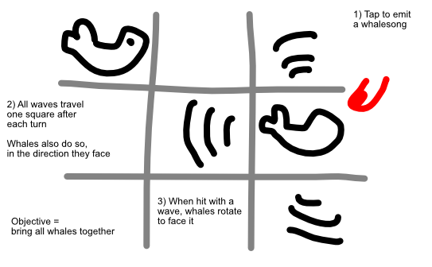

Grid-based puzzler about letting whales communicate through the water.

## Objective

Make all whales meet each other.

## Input/Action

Tap a **square with a living being on it**. That being will emit a whalesong. What it *does* is specific to the creature.

> **IDEA:** The more whales are on a square, the faster its song travels? (Might be a rule enabled later on.)

## Turns

Each turn, the whalesongs ( = waves on water) travel one step further. When hit by a wave, whales rotate to face that way. Whales auto-move at the end of each turn (if possible).

> If two whales are on the same square ... remove them from the field? Might make puzzles easier to grasp and solve. Use this at the start, enable the other rule at the end?

So each turn has these phases:

-   Wait for input
-   Update waves/whalesongs => one step further, rotate whale to match direction
-   Move whales in order => one step in direction they're facing

Specialties:

-   **Plankton:** tap to attract whales, when eaten you get something special?
-   **Constant:** once turned on, keeps emitting indefinitely
-   **Lazy:** won't auto-move; waits until it has been activated
-   **Something that blocks the song or stops a whale from moving**

**PROBLEM:** We update waves simultaneously. But ... what direction should whales choose then?

> **SOLUTION:** If multiple waves hit each other, they cancel each other out and nothing happens.

Campaign = different island groups with whales in squares. The whales have a number = click them to start the level.

## Ads

The default puzzle stuff. (Undo, Hint, Unlock new world, Cosmetics, Multiplayer Mode?)
